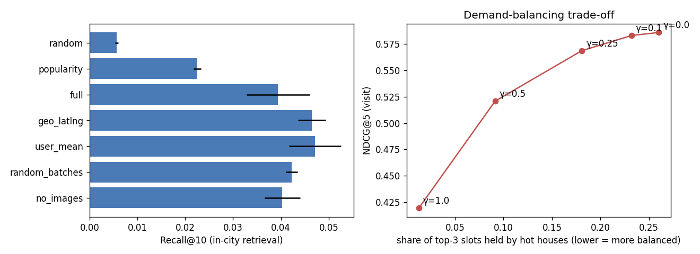

# E7.0: Can a toy rebuild of a modern housing discovery stack reproduce its design claims on synthetic data?

- **Roadmap phase**: [Phase 7](../00-plan/roadmap.md#phase-7-multi-task-ranking-and-joint-retrieval-and-ranking) (end-to-end preview touching Phases 3, 5, 6, 7, 8) · Hypothesis ladder rung: preview
- **Status**: done
- **Started / finished**: 2026-11-23 / 2026-11-23
- **Code**: [`mini-recsys/`](./mini-recsys/) · raw outputs in [`mini-recsys/results/`](./mini-recsys/results/)

## Why this experiment

Before working through the roadmap phase by phase, I wanted to build the *whole* stack once, small enough to fit in my head and run on a laptop, so every later phase has something concrete to attach to. The reference architecture is the one QuintoAndar has described publicly (blog posts *Location Matters* and *Learning the Journey*). It has five parts:

1. **Multi-resolution geo-embeddings**: an H3-style cell embedded at several resolutions.
2. **A shared house encoder**: tabular features + geo + photos, with photos added through a zero-initialised gate α.
3. **A sequential user tower**: self-attention over the houses the user engaged with, plus event-type and recency embeddings.
4. **Contrastive retrieval**: InfoNCE with in-batch negatives, duplicate masking, a learnable τ and city-grouped batches.
5. **Ranking and policy**: a multi-target search head trained jointly with retrieval, then a multiplicative demand-balancing policy on top.

Everything is reimplemented from scratch (my take) on a **synthetic** marketplace. No company code, data or metrics are used.

## Hypotheses (written before the full run)

Each ablation flips exactly one switch of the `full` model.

| ID | H | Null | Success criterion |
|---|---|---|---|
| H1 geo | Multi-res cell embeddings beat raw lat/lng on in-city Recall@10 | `geo_latlng` ≥ `full` | `full` − `geo_latlng` > 1 std of the two |
| H2 sequence | Attention over the history beats a mean of the history, because users drift | `user_mean` ≥ `full` | same as H1 |
| H3 negatives | City-grouped batches beat random batches on **in-city** Recall@10 | `random_batches` ≥ `full` | same as H1 |
| H4 search head | (a) The two-tower dot product loses to a GBDT with user×house gap features in-search; (b) the search head closes the gap | head ≤ GBDT | head NDCG@5 (offer) ≥ GBDT |
| H5 policy | Some γ > 0 cuts demand concentration a lot at a small relevance cost | no γ gives both | ≥ 30% relative cut in hot-house share of the top-3 slots for ≤ 5% relative NDCG@5 loss |

## Knowledge tested

- *Domain*: location substitutability, preference drift within a journey, cold start, availability-driven visits, demand concentration on perishable inventory.
- *Technical*: two-tower models, InfoNCE and false negatives, hard negatives via batch composition, a transformer user encoder, gated multimodal fusion, multi-target BCE with pos_weight and calibrated score fusion, joint loss, NDCG/MRR/coverage, Information Abundance.

## Design

- **Data**: a simulator ([`synth_data.py`](./mini-recsys/synth_data.py)), not a public dataset, so the ground truth is known.
  - 3 cities, 4,500 houses, 4,000 users, about 40k search sessions with 12 candidates each, about 178k events.
  - The mechanics and why each one exists are in the [mini-recsys README](./mini-recsys/README.md#how-the-simulator-maps-to-the-real-problem).
- **Splits**: temporal. Training sessions run up to day 60, then a 7-day gap, then validation sessions from day 67 to 90. History and popularity features are always point-in-time (strictly before the session).
- **Retrieval protocol**:
  - For each validation user, the query fires at their first validation session, using all events before it.
  - Positives are the houses with a favorite, share, visit or offer in the next 14 days.
  - The whole catalogue is ranked, both globally and restricted to the user's city. Metrics are not sampled.
  - About 40% of validation users have no history. They are excluded from retrieval scoring and counted in the logs.
- **In-search protocol**: re-rank the 12 shown candidates of each validation session. NDCG@5 is computed on the offer and visit labels.
- **Models**:
  - `full` and 4 single-switch ablations, plus a `no_images` sanity check.
  - Baselines: random, popularity (point-in-time) and an sklearn `HistGradientBoostingClassifier` on 14 hand-crafted features (price gap to the user's history, distance to the mean and the last location, same-cell counts, image affinity, visit slots, 14-day popularity, fit to the filters).
- **Training**: AdamW 3e-3, 20 epochs, batch 256. Loss = InfoNCE + 2·search BCE. Embedding size d = 32.
- **Seeds**: 3. A new world, a new model init and a new GBDT for each seed. The full run took about 6 minutes per seed on a laptop CPU.

### Deviation from the plan (honest note)

The first smoke test used a single query at day 60 with labels covering the whole validation window. 62% of those queries were cold-start users, so popularity beat every model and the comparison said nothing about the architecture. I switched to the online-style protocol above **before** the full run. The hypotheses and criteria did not change.

## Results

3 seeds, mean ± std. Full tables: [`results_full.md`](./mini-recsys/results/results_full.md).

**Retrieval, in-city, warm users**

| Model | Recall@10 | NDCG@10 | MRR | Coverage@10 | Info. abundance (/32) |
|---|---|---|---|---|---|
| random | 0.006 ± 0.000 | 0.008 ± 0.001 | 0.039 | 0.92 | — |
| popularity | 0.023 ± 0.001 | 0.034 ± 0.001 | 0.106 | 0.01 | — |
| **full** | 0.039 ± 0.007 | 0.056 ± 0.008 | 0.144 | 0.49 | 4.6 ± 0.5 |
| geo_latlng | 0.046 ± 0.003 | 0.064 ± 0.005 | 0.163 | 0.59 | 5.1 ± 0.2 |
| user_mean | **0.047 ± 0.005** | **0.067 ± 0.006** | **0.168** | 0.62 | 5.6 ± 0.3 |
| random_batches | 0.042 ± 0.001 | 0.059 ± 0.002 | 0.150 | 0.52 | 5.0 ± 0.2 |
| no_images | 0.040 ± 0.004 | 0.057 ± 0.006 | 0.144 | 0.53 | 4.6 ± 0.2 |

`full` also had the only noticeable gap between global and in-city Recall@10 (0.032 ± 0.014 vs 0.039). In one seed it leaked recommendations to other cities. The other variants show no such gap.

**In-search ranking, 12 candidates**

| Model | NDCG@5 offer | NDCG@5 visit |
|---|---|---|
| popularity | 0.457 ± 0.003 | 0.469 ± 0.001 |
| GBDT (gap features) | 0.539 ± 0.004 | 0.560 ± 0.003 |
| full · dot product | 0.432 ± 0.020 | 0.448 ± 0.019 |
| **full · search head** | **0.575 ± 0.016** | **0.586 ± 0.016** |
| user_mean · search head | 0.583 ± 0.007 | 0.595 ± 0.007 |
| geo_latlng · search head | 0.547 ± 0.003 | 0.560 ± 0.002 |
| no_images · search head | 0.548 ± 0.010 | 0.562 ± 0.010 |

**Policy on the `full` search head: score × (1 − demand)^γ**

| γ | NDCG@5 visit | Hot-house share of the top-3 slots |
|---|---|---|
| 0 | 0.586 | 0.260 |
| 0.1 | 0.583 (−0.5%) | 0.232 (−11%) |
| **0.25** | **0.569 (−2.9%)** | **0.181 (−30%)** |
| 0.5 | 0.521 (−11%) | 0.091 (−65%) |
| 1.0 | 0.419 (−29%) | 0.013 (−95%) |

## Conclusion

- **Verdicts**:
  - **H1 rejected**: lat/lng was better (0.046 vs 0.039).
  - **H2 rejected**: the mean of the history was better (0.047 vs 0.039).
  - **H3 rejected / inconclusive**: random batches 0.042 vs 0.039, inside the noise of `full`.
  - **H4 supported**:
    - (a) dot product 0.432 < GBDT 0.539;
    - (b) search head 0.575 > GBDT 0.539, more than 2 std apart.
  - **H5 supported**: γ = 0.25 gives a 30% concentration cut for a 2.9% NDCG loss.
- **What I learned**:
  - **The ranking-layer story reproduces cleanly.** Embeddings alone lose to a GBDT in-search. A head over `[u⊙h, u−h, u, h, c, c⊙h, s]` plus search-only features (visit slots, rolling popularity) beats the GBDT. This is the robust result of the PoC.
  - **Photos earn their gate.** α grew from 0 to about 0.13. Removing images cost about 0.027 NDCG@5 in-search, but nothing measurable in retrieval. That fits the simulator, where style is a weak per-user signal.
  - **The fancier retrieval components did *not* pay off at toy scale (my take).** The likely causes are below. I checked none of them, and each one is a follow-up:
    1. *Geo*: only about 1k houses per city and a 16×16 fine grid give about 6 houses per fine cell. The embedding tables are under-trained, while xy is a smooth 2-number input that an MLP handles easily. In the simulator, substitutability is a *coarse-cell type*, which lat/lng plus an MLP can partly carve out.
    2. *Sequence*: with ≤ 20 events and the drift happening once (at mid-journey), a mean that is dominated by recent clicks may already track the drift. The transformer (2 layers, 4 heads, about 23k training sessions) is also the highest-variance component.
    3. *Negatives*: users only ever search their own city, so the in-city ranking signal is already present in random batches. City grouping mostly changes the *global* geometry.
    4. *Collapse*: Information Abundance is about 5 of 32 for every variant. The embeddings use few dimensions. The simulator's true preference space is low-dimensional (type, anchor, budget, style), so this may be a property of the data rather than a failure.
  - **Policy is a dial, not a free lunch.** Concentration drops much faster than NDCG for small γ, but the offline NDCG cost is the *only* side you can see offline. Any marketplace benefit (houses rented faster, less congestion) needs an interference-aware simulation or an A/B test ([Phase 9](../00-plan/roadmap.md#phase-9-evaluation-science-and-marketplace-experiments)).
- **Caveats**:
  - Synthetic data: the result can only be as true as the simulator.
  - 3 seeds only, no confidence intervals beyond the std.
  - Labels are generated from shown candidates, so exposure bias exists by construction.
  - The GBDT was not tuned.
  - Cold-start users (about 40%) were not evaluated in retrieval.
- **Progress signal met?**: Yes for the goal of the PoC, a runnable end-to-end stack with measurable components. No for "every component helps", which is the useful lesson.
- **Next step**:
  1. E7.0b: scale the world (10× houses per cell, multi-switch drift) and rerun H1–H3 to separate "wrong idea" from "too small".
  2. Add an interference-aware capacity simulation to evaluate H5 on outcomes rather than NDCG.
  3. Then return to the roadmap at [E0.1](../00-plan/roadmap.md#phase-0-foundations-metrics-and-evaluation-harness).
