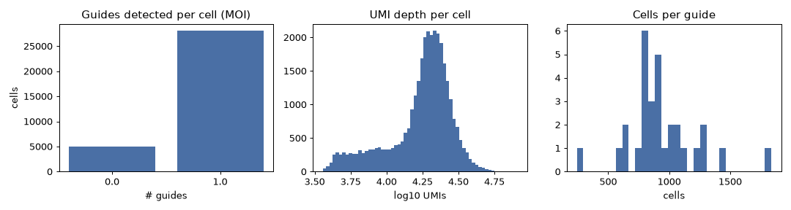
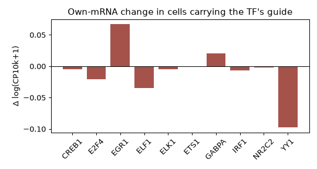
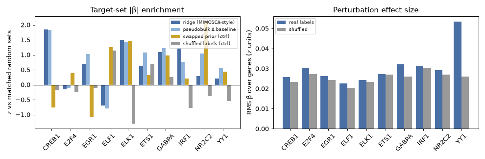

# E0.2: Do knockouts move their known targets?

- **Roadmap phase**: [Phase 0](../../00-plan/roadmap.md#phase-0-foundations) · Hypothesis ladder rung: 0
- **Status**: running
- **Started / finished**: 2026-11-25 / -

> **Pre-registration.** Hypothesis, Why, Knowledge tested, Design and Metric were written on 2026-11-25 *after* the EDA (`scripts/eda_dixit.py`) and the synthetic sanity run, but *before* the confirmatory run on real data (`scripts/run_e0_2.py`). The EDA changed one thing in the design, logged under Design ("knockdown readout").

## Hypothesis

- **H**: in the Dixit 2016 K562 Perturb-seq screen (CRISPR-Cas9 knockout of 10 TFs), the MIMOSCA-style effect vector of a TF moves that TF's CollecTRI targets more (larger mean |β|) than 1000 random gene sets with the same expression distribution.
- **Null**: target sets and expression-matched random sets move equally (permutation p roughly uniform; few TFs pass FDR).

## Why it moves the research forward

It checks that (a) the perturbation signal in a pooled screen is real after modelling guides and depth, and (b) it follows curated regulatory structure. If it does, GRN priors are worth feeding into perturbation models (Phase 4). If not, either the knockouts are weak, the prior is wrong for K562, or effects are mostly indirect, and each of those tells me which data/prior to distrust. **(my take)**

## Knowledge tested

- *Domain*: TF biology, direct vs indirect targets, why a Cas9 knockout may not lower the TF's mRNA (frameshift indels, partial nonsense-mediated decay), cell-type specificity of TF→target edges, MOI and guide assignment in pooled screens.
- *Technical*: linear models with indicator design + covariates (MIMOSCA), ridge, pseudobulk Δ, expression-matched permutation nulls, BH FDR, label-shuffle negative controls.

## Design

- **Data**: GEO [GSM2396858](https://www.ncbi.nlm.nih.gov/geo/query/acc.cgi?acc=GSM2396858) (`k562_tfs_7`): K562, 10 TFs (CREB1, E2F4, EGR1, ELF1, ELK1, ETS1, GABPA, IRF1, NR2C2, YY1) + intergenic controls, 30 guides, 33,013 cells x 23,111 genes, day 7. This is the driving paper's own data. Deviation: the pertpy `dixit_2016` / `norman_2019` h5ad files are 1.5 / 1.7 GB, above the 500 MB budget, so I read the 327 MB GEO files directly. Only 10 TFs exist, fewer than the roadmap's 20–50.
- **Prior**: CollecTRI from OmniPath (64k TF→target edges with sign). A TF is testable if it has ≥ 10 targets among genes detected in ≥ 5% of cells.
- **Preprocessing**: keep cells with ≥ 1 assigned guide; genes detected in ≥ 5% of cells; CP10k → log1p → z-score per gene.
- **Model (MIMOSCA-style)**: `Z = b0 + P β + C γ + ε`, P = TF indicators (intergenic = reference), C = standardized log UMI and log detected genes, ridge λ = 1. β is a 10 x genes matrix of effect vectors.
- **Baseline**: pseudobulk Δ (mean z of single-TF cells minus mean of control-only cells), same test.
- **Negative controls**: (1) shuffle perturbation labels across cells, refit, retest; (2) swapped prior: test TF k's β against the next TF's target set.
- **Test**: score = mean |β| over targets (TF's own gene removed). Null = 1000 sets where each target is replaced by a random gene from the same expression decile. p = (1 + #null ≥ obs)/1001, then BH over TFs. Secondary: signed score `mean(−sign·β)` (KO of an activator should lower its targets).
- **Knockdown readout (changed after EDA)**: the roadmap's plan was to restrict to TFs with good knockdown, measured as a drop in the TF's own mRNA. EDA shows Cas9 KO barely changes own mRNA (|Δlog| < 0.1 for all 10 TFs, figure below), so own mRNA is not a valid knockdown readout here. The denominator is therefore **all testable TFs**; own-mRNA change is reported, not used as a filter.
- **Code**: [`perturbseq-mini/`](./) (`scripts/eda_dixit.py`, `scripts/run_e0_2.py`); synthetic check with ground truth in `results/E0.2/synthetic/`.

## Metric and success criterion

- **H supported** if ≥ 50% of testable TFs reach q < 0.1 on the ridge |β| score **and** the shuffled-label control has ≤ 1 TF at q < 0.1.
- **H rejected** if < 50% pass with a clean negative control. **Inconclusive** if the shuffled-label control flags > 1 TF.
- **Progress signal (a priori fail list, written before the run)**: ETS1 (essentially not expressed in K562: detected in 0.04% of control cells, so knocking it out should do nothing), IRF1 and NR2C2 (low expression, ~8% detection; IRF1 is interferon-induced and probably inactive at baseline). I predict the other 7 pass. Success = more than half of the 10 calls right.

## Data primer

- **What the assay measures** (paper): Perturb-seq pools many CRISPR guides in one dish. Each lentivirus carries a guide plus a *polyadenylated guide barcode* (GBC) transcript, so single-cell RNA-seq reads both the cell's transcriptome and which guide(s) it got. One experiment = thousands of knockouts with a single-cell readout.
- **Cas9 knockout, not CRISPRi** (my take, important): Cas9 cuts and leaves indels. A frameshift kills the *protein*, but the mRNA is often still made; only nonsense-mediated decay lowers it, partially. So "did the knockout work?" cannot be read from the TF's own mRNA. CRISPRi (Replogle 2022) silences transcription and *can* be checked that way.
- **Technical biases**: (1) guide assignment is noisy: the GBC transcript is captured with some probability, so some cells look unperturbed or carry a wrong label; (2) MOI > 1 cells carry two perturbations (the paper's design deliberately allowed this); (3) a guide that cuts in-frame leaves a working protein, so even correctly labelled cells can be unperturbed ("escapers", which MIMOSCA's EM step tries to down-weight); (4) UMI depth varies ~10x between cells and drives most variance, hence the depth covariates; (5) 7 days of growth after infection: indirect and compensatory effects accumulate.
- **Dataset quirks found**: the GEO guide dictionary assigns **exactly one guide** to every assigned cell (0% of cells with ≥ 2), so the MOI information was filtered upstream and the multi-guide (additive) part of MIMOSCA is untestable here. 15% of cells have no guide. Median 19,433 UMIs and 3,811 genes per cell, unusually deep for 2016 droplet data; I did not verify whether the matrix holds UMIs or reads (uncertain). Only 30 guides (2–4 per TF, 4 intergenic).

## EDA findings

Numbers from `results/E0.2/eda.json`:

1. **MOI is 0 or 1 only** (85% one guide, 15% none). *ML*: the design matrix P is one-hot, so the ridge model reduces to (shrunk, depth-adjusted) group means and the pseudobulk baseline is nearly the same estimator. The results confirm it: ridge and pseudobulk z-scores track each other.
2. **Depth has a low-UMI shoulder** below ~10k UMIs. *Tech*: lower-quality or partially lysed cells. *ML*: a nuisance covariate that can masquerade as a perturbation if guide groups differ in depth, hence log UMI and log genes in C.
3. **Cells per guide ~250–1,850** (1,402–4,220 single cells per TF, 5,381 control cells). *Stats*: plenty of cells; power is limited by effect size, not n.
4. **Own-mRNA "knockdown" is ~0 for all 10 TFs** (Δlog(CP10k+1) from −0.10 (YY1) to +0.07 (EGR1)). *Biology*: Cas9 KO kills protein, not transcript. EGR1 even goes *up* in its own knockout, plausibly negative autoregulation: EGR1 protein represses its own promoter, so losing the protein de-represses the (broken) transcript (my take). This forced the design change above.
5. **ETS1 is essentially not expressed** in K562 (detected in 0.04% of control cells). *Biology*: a TF that is absent cannot be knocked out; its "effects" are a built-in negative control.
6. **CollecTRI coverage**: 20 (GABPA) to 189 (CREB1) targets among expressed genes. *Biology*: CollecTRI pools evidence across cell types, so many edges may be inactive in K562.

## Paper → minimal architecture

| Paper (Dixit 2016, MIMOSCA) | Here | Why |
|---|---|---|
| Linear model: expression ~ guide indicators + covariates | **kept** (ridge, closed form) | The core idea: one effect vector per perturbation, confounders regressed out |
| Elastic net regularization | ridge λ = 1 | Same purpose (shrinkage); ridge is a one-line solve, enough for 10 perturbations |
| EM step re-weighting cells by the probability that the guide worked | **cut** | Biggest omission; probably matters here (in-frame escapers). Next step |
| Cell-state covariates, guide×guide interactions | cut | No MOI > 1 in the GEO dictionary; keep it minimal |
| Per-guide coefficients | collapsed to per-TF | 2–4 guides per TF; per-guide would test guide quality, not TF→target structure |
| Gene-set test vs curated targets | **added** | The E0.2 question, with expression-matched permutation nulls |

## Results

Full run (`perturbseq-mini/results/E0.2/full/results.json`, seed 0, 28,034 cells x 9,685 genes, 1000 null sets, 17.5 s on CPU). Quick run (8,000 cells, 200 sets) in `results/E0.2/quick/`.

| TF | targets | z (ridge) | p | q | q pseudobulk | q shuffled | own β | RMS β real / shuffled |
|---|---|---|---|---|---|---|---|---|
| CREB1 | 189 | 1.84 | 0.034 | 0.31 | 0.26 | 0.87 | −0.02 | 0.026 / 0.023 |
| E2F4 | 142 | −0.15 | 0.55 | 0.61 | 0.61 | 0.87 | −0.07 | 0.030 / 0.027 |
| EGR1 | 140 | 0.70 | 0.25 | 0.44 | 0.26 | 0.87 | +0.20 | 0.026 / 0.024 |
| ELF1 | 33 | −0.69 | 0.75 | 0.75 | 0.79 | 0.87 | −0.12 | 0.023 / 0.020 |
| ELK1 | 32 | 1.50 | 0.075 | 0.31 | 0.26 | 0.91 | −0.02 | 0.024 / 0.023 |
| ETS1 | 89 | 0.64 | 0.26 | 0.44 | 0.26 | 0.87 | n/a | 0.027 / 0.027 |
| GABPA | 20 | 1.10 | 0.12 | 0.31 | 0.26 | 0.87 | +0.09 | 0.032 / 0.026 |
| IRF1 | 59 | 1.20 | 0.12 | 0.31 | 0.33 | 0.87 | −0.05 | 0.031 / 0.030 |
| NR2C2 | 26 | 0.29 | 0.37 | 0.49 | 0.26 | 0.87 | −0.01 | 0.029 / 0.027 |
| YY1 | 124 | 0.21 | 0.39 | 0.49 | 0.37 | 0.87 | −0.20 | 0.054 / 0.026 |

- **Primary**: 0/10 TFs at q < 0.1 (best: CREB1, nominal p = 0.034). Signed test: 0/10. Pseudobulk baseline: 0/10.
- **Negative controls**: shuffled labels 0/10, swapped prior 0/10. The test is not anti-conservative; it simply finds nothing.
- **Effect size**: only **YY1** has a clearly non-null global effect (RMS β 0.054 vs 0.026 shuffled; its top up-regulated genes are ribosomal proteins RPL11, RPL35A, RPS7, RPL37, RPL38). The other 9 TFs sit within ~20% of the shuffled-label noise floor. Even YY1's effect is not concentrated on its CollecTRI targets.
- **Quick run** (8k cells): CREB1 and IRF1 reach q = 0.05, not reproduced with all cells. A subsampling fluke, reported for honesty.
- **Synthetic positive control** (`results/E0.2/synthetic/`): the same pipeline flags 6/6 live TFs (q = 0.001, signed score in the right direction for 6/6), 0/2 dead TFs, 0 shuffled false positives. The pipeline detects target-set shifts when they exist.
- **Deviations**: GEO files instead of pertpy (size); 10 TFs instead of 20–50; knockdown filter replaced by an all-TF denominator (pre-registered after EDA).

## Conclusion

- **Verdict**: **H rejected** (0/10 TFs significant; negative controls clean; synthetic positive control works).
- **What I learned**:
  - In this screen most TF knockouts barely move the transcriptome (effect RMS ≈ shuffled noise), so "do they move their targets" fails one step earlier, at "do they move anything". YY1 is the exception. Likely causes (my take): in-frame escapers diluting each group (the EM step I cut), redundancy among ETS-family TFs (ELK1/ELF1/GABPA/ETS1 share the same motif), and TFs inactive in K562 (ETS1, IRF1).
  - A Cas9 KO cannot be QC'd from its own mRNA; CRISPRi data or protein/indel readouts are needed for a knockdown filter.
  - Generic curated priors (CollecTRI) pool many cell types. A null here does not say the edges are wrong, only that they are not the dominant K562 response.
- **Progress signal met?**: **no**. My a priori fail list (ETS1, IRF1, NR2C2) was right for those 3, but I predicted the other 7 would pass and all failed: 3/10 correct. I overestimated knockout potency in this screen.
- **Next step**: (1) add a MIMOSCA-style EM step that down-weights non-responding cells and check whether YY1/CREB1/ELK1 become significant; (2) rerun E0.2 on a CRISPRi screen (Replogle 2022 K562 essential) with the own-mRNA knockdown filter the roadmap originally planned.
