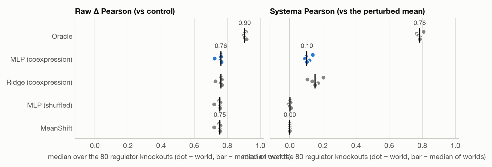
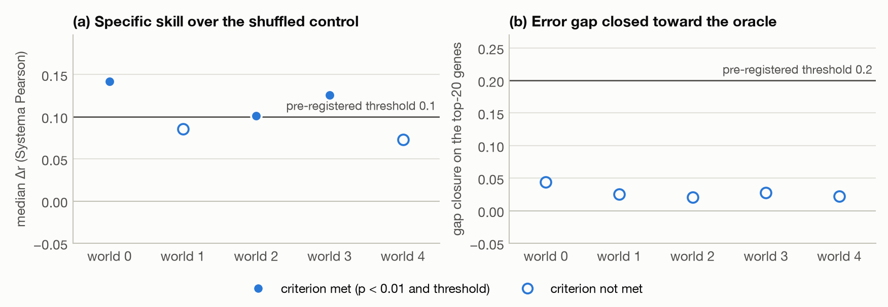
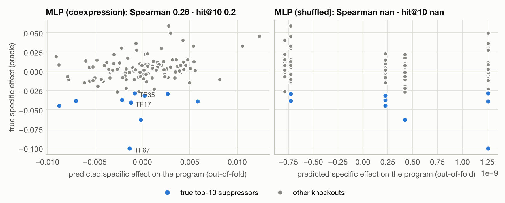

# E0.4: Can a minimal virtual cell predict knockouts it has never seen?

- **Roadmap phase**: [Phase 0](../00-plan/roadmap.md#phase-0-foundations) · Hypothesis ladder rung: 0
- **Status**: done
- **Started / finished**: 2026-10-31 / 2026-10-31

> **Pre-registration.** The Hypothesis, Why, Knowledge tested, Design and Metric sections were written on 2026-10-31, before any model was trained or evaluated. Results and Conclusion are filled in from `results/E0.4/` after the confirmatory run. Any deviation is listed under Results.

## Hypothesis

- **H**: take a synthetic toy cell with a known gene regulatory network (GRN). In it, a **minimal virtual cell** represents each knockout by the knocked-out gene's co-expression profile in *control cells only*. It maps that embedding through an MLP to a change in expression (Δ), which it adds to the control state. This model predicts the *specific* response to regulator knockouts it has never seen. It does so better than the same model with shuffled embeddings, and with lower error than the mean-shift baseline.
- **Null**: one of two things happens, and either way the apparent skill comes from the response shared by all perturbations or from embedding statistics, not from gene-specific information:
  - The co-expression model is no better than the shuffled-embedding control (Δr ≈ 0).
  - Its error on the most affected genes is no lower than the mean-shift baseline's.

## Why it moves the research forward

Every later experiment needs the same harness:
- a simulator with ground truth;
- splits by unseen perturbation;
- the mean and linear baselines;
- metrics corrected for systematic variation;
- positive and negative controls.

E0.4 builds that harness and checks that it can detect real generalization *before* any real data is involved. This is the [E0.3](../00-plan/roadmap.md#experiments--hypotheses) logic applied to a whole pipeline: understand an evaluation on simulated data before trusting it on real models. **(my take)**

- **If H holds**, the minimal Δ-MLP with co-expression embeddings is a working baseline for unseen perturbations. The same harness then moves on in three directions:
  - real data (Replogle 2022 K562 essential pseudobulk);
  - richer perturbation embeddings (GRN priors, text or protein embeddings);
  - context, a toy version of the Master's H1, where chromatin accessibility gates which edges are active.
- **If H fails**, there are two possible explanations:
  - The toy signal is too weak. The oracle ceiling and the pilot distinguish this case.
  - A minimal model can't extract gene-specific information from about 72 training knockouts.

  Either way, priors (GEARS-style GRN embeddings) or more perturbations are needed before any real-data model. That is cheaper to learn here, where the truth is known. **(my take)**

## Knowledge tested

- *Domain*:
  - How a knockdown propagates through a GRN (direct vs indirect targets).
  - CRISPRi knockdown efficiency and escaper cells.
  - The generic response shared by every perturbation (systematic variation).
  - **Observational co-expression vs interventional effect**, P(Y | X) ≠ P(Y | do(X)). A target gene is co-expressed with its regulator, but knocking it out moves nothing.
  - Count noise (negative binomial), and why normalization is needed.
- *Technical*:
  - Δ prediction with a residual, zero-initialized MLP.
  - Perturbation-level cross-validation, which tests unseen perturbations.
  - Perturbation representations for genes the model has never seen.
  - Systema-corrected vs raw Δ-Pearson.
  - Label-shuffled negative controls and leaky positive controls.
  - Paired Wilcoxon tests.
  - Oracle noise ceilings and gap closure.

## Design

- **Data**: a synthetic toy cell from [`vcell.simulate`](../vcell/src/vcell/simulate.py). No real or patient data is used, so there is no entry in [datasets](../03-data/datasets.md).
  - **World**: 500 genes. 80 of them are regulators (`TF00–TF79`), including 10 master regulators with no parents. The other 420 are targets (`G080–G499`).
    - The GRN is a DAG. Non-master regulators have 1–2 regulator parents, and targets have 1–3.
    - Edge strengths are |w| ~ U(0.3, 1.0), activating with p = 0.7.
  - **Expression**: latent log-expression is `x_i = b_i + Σ_j w_ji · tanh(x_j − b_j) + 0.3 · ε_i`, with b ~ N(1, 0.8).
    - Counts are NB(μ = s_c · e^x, θ = 10).
    - Library factor s_c ~ LogNormal(0, 0.3).
  - **Screen**: 2,000 non-targeting control cells, plus 100 cells for each of 120 CRISPRi knockdowns. The knockdowns are all 80 regulators and 40 non-regulator "null" genes.
    - In 80% of cells the knockdown works (responders), lowering `x_k` by kd ~ U(1.5, 2.5) log-units. That change propagates downstream. The other 20% are escapers.
    - Every targeting-guide cell also gets a shared 25-gene stress program on non-regulator genes, with strength γ_k ~ U(0.5, 1.5) per knockout. This is the systematic variation.
  - **Preprocessing**:
    - Counts are normalized to 10⁴ per cell, then log1p.
    - The pseudobulk is the mean per knockout.
    - Δ = pseudobulk − control mean.
    - Each knockout's own gene is masked everywhere: loss, references and metrics.
  - **Oracle**: the expected Δ in the same observed space, computed by Monte Carlo (4,000 cells per knockout, common random numbers). It is used only as the ceiling, for gene selection, and as Explain/Discover ground truth. It is never used for training.
- **Splits**:
  - Five independent worlds (seeds 0–4). Each has its own GRN, cells, folds and initialization, derived with `SeedSequence(w).spawn`.
  - Within a world, the knockouts are split into 5 folds, stratified by regulator vs null.
    - Test = fold f.
    - Validation = fold f+1, used for early stopping and the ridge λ.
    - Train = the remaining three folds (72 knockouts).
  - **OOD definition**: test knockouts are never seen in training (unseen perturbation). Control cells are shared.
  - Every knockout gets exactly one out-of-fold prediction.
  - The pilot uses world 1000, and debugging happens only on dev worlds ≥ 1001. Worlds 0–4 are not touched before the pilot passes.
- **Models and baselines** (fitted on the training folds only):
  - **MeanShift**: the mean training Δ. This is the tutorial's simple baseline and Systema's perturbed-mean reference.
  - **Ridge (coexpression)**: closed-form ridge from the centered embedding to the centered Δ, with λ ∈ {10⁻³…10³} chosen on validation. As λ → ∞ it becomes MeanShift. This is the linear baseline.
  - **MLP (coexpression)**: the minimal virtual cell.
    - Embedding: PCA loadings (d = 64) of the gene–gene correlation matrix of control cells, with signs canonicalized and scaled to a mean row norm of 1.
    - Architecture: `Linear(64→64) → GELU → Linear(64→500)`.
    - The output layer has zero weights and its bias set to the training mean Δ, so the model starts *exactly* at MeanShift.
    - Training: masked MSE on Δ, AdamW (lr 10⁻³, weight decay 10⁻⁴), full batch, at most 2,000 epochs, early stopping on validation (patience 100) with the best weights restored. The initial state is a candidate.
  - **MLP (shuffled)**: the negative control. It is the same model, with the co-expression embeddings permuted among knockouts *within* the regulator and null groups. The marginals and class information stay the same, but the gene-specific link is gone.
  - **Oracle**: the ceiling.
  - **MLP (oracle embedding)**, pilot only: the leaky positive control. Its embedding is the PCA of the oracle Δ, so the answer is built in.
  - **Deviation from the tutorial, decided a priori**: no LayerNorm in the hidden layer. LayerNorm rescales each sample, which would erase the embedding norm, and here the norm encodes how strongly a gene is wired into the GRN. **(my take)**
- **Code / notebook**:
  - [`../vcell/`](../vcell/): [`scripts/run_e0_4.py`](../vcell/scripts/run_e0_4.py) (pilot and confirmatory run) and [`notebooks/E0.4-walkthrough.ipynb`](../vcell/notebooks/E0.4-walkthrough.ipynb).
  - Results are in [`results/E0.4/`](../vcell/results/E0.4/).
  - Code state: on top of commit `9ffec8d` (uncommitted when run).

## Metric and success criterion

All metrics are computed per knockout and exclude the knocked-out gene itself.

- **`pearson_systema`** (primary): the Pearson correlation over genes between (prediction − μ_train) and (measurement − μ_train). μ_train is the mean training Δ of that fold, i.e. Systema's perturbed-mean reference. It is 0 when the prediction residual is constant, which is always the case for MeanShift.
- **`mse_top20`**: the MSE of Δ over the 20 genes with the largest oracle-specific effect |oracle Δ_k − mean oracle Δ|. The genes are selected by the oracle, so there is no selection bias from test noise, and the shared stress genes are excluded.
- **`gap_closure`** = (MSE_MeanShift − MSE_model) / (MSE_MeanShift − MSE_Oracle) on `mse_top20`, computed as a ratio of means over knockouts. 0 = MeanShift, 1 = Oracle.

**Decision rule.** For each world, on the out-of-fold predictions for the 80 regulator knockouts:
- **(a)** Δr_k = r_systema(MLP coexpression) − r_systema(MLP shuffled). The one-sided Wilcoxon signed-rank p must be < 0.01 **and** the median Δr ≥ 0.1.
- **(b)** `mse_top20`(MLP coexpression) < `mse_top20`(MeanShift). The one-sided Wilcoxon signed-rank p must be < 0.01 **and** `gap_closure` ≥ 0.2.

**Verdict**:
- **H supported** if (a) and (b) both hold in **≥ 4 of 5 worlds**.
- **Inconclusive** if they hold in 2–3 worlds.
- **H rejected** if they hold in ≤ 1 world.

**Pilot gate** (world 1000). It must pass before worlds 0–4 are run. The co-expression model is never evaluated in the pilot.
1. The oracle's median `pearson_systema` on regulators is ≥ 0.7, so the effects are measurable at 100 cells per knockout. If it fails, raise the cells per knockout.
2. The leaky positive control, MLP (oracle embedding), passes (a) and (b), so the harness has the power to detect real skill.
3. The negative control, MLP (shuffled), has median `pearson_systema` ≤ 0.1 and `gap_closure` ≤ 0.1, so the harness does not leak.
   - The check is one-sided. Class-level information (regulator vs null) can legitimately move r a little in either direction. Only gene-specific skill would point to a leak.

**Exploratory** (reported, no thresholds):
- MLP vs Ridge ("is deep needed?").
- Raw `pearson_delta` vs Systema, which shows the systematic-variation trap.
- **Explain**: precision@K of the top predicted genes against the true GRN descendants, with K = min(20, number of descendants).
- **Discover**: an in-silico screen. All 120 knockouts are ranked by their predicted effect on a 20-gene "disease program" drawn from the descendants of 3 seeded regulators. The ranking is compared with the oracle's (Spearman and hit@10).
- **Null-knockout AUROC**: how well the predicted effect size separates regulators from nulls. We expect it to be > 0.5, with false positives for null genes that sit inside regulator modules.
- A collapse diagnostic: the SD of predicted Δ across knockouts.
- The gap to the oracle.

## Results

The source of every number below is [`results/E0.4/`](../vcell/results/E0.4/) (`summary.csv`, `decision.json`). Seeds: worlds 0–4, pilot world 1000. Compute: about 110 s on an M3 Pro CPU, 1 thread. Two runs produced byte-identical CSV and JSON files.

**Pilot (world 1000): passed.**
- Oracle ceiling r = 0.795.
- Positive control: Δr = 0.38 and gap closure 0.30.
- Negative control: r = −0.004.

**Median over worlds**, on the 80 regulator knockouts:

| Model | Systema r | raw Δ r | gap closure | precision@K | null AUROC | screen ρ |
| --- | --- | --- | --- | --- | --- | --- |
| MeanShift | 0.000 | 0.755 | 0.00 | 0.00 | 0.50 | — |
| Ridge (coexpression) | 0.151 | 0.761 | 0.036 | 0.20 | 0.49 | 0.19 |
| MLP (coexpression) | 0.103 | 0.761 | 0.026 | 0.15 | 0.52 | 0.12 |
| MLP (shuffled) | 0.001 | 0.755 | 0.00 | 0.05 | 0.51 | 0.03 |
| Oracle | 0.784 | 0.905 | 1.00 | 1.00 | 0.99 | 0.99 |

**Decision per world:**
- **(a) median Δr against the shuffled control**: 0.142, 0.085, 0.101, 0.126, 0.073. Every p ≤ 2×10⁻⁴, so (a) passes in worlds 0, 2 and 3.
- **(b) gap closure**: 0.021–0.044 (p < 10⁻⁸). This fails in all 5 worlds.

<picture><source media="(prefers-color-scheme: dark)" srcset="../vcell/results/E0.4/figures/fig1_specific_skill-dark.png"></picture>
<picture><source media="(prefers-color-scheme: dark)" srcset="../vcell/results/E0.4/figures/fig2_decision-dark.png"></picture>
<picture><source media="(prefers-color-scheme: dark)" srcset="../vcell/results/E0.4/figures/fig3_screen_world0-dark.png"></picture>

**Deviations**, all decided before worlds 0–4 were run:
1. `cells_per_pert` was raised from 100 to 200, the pre-registered remedy. The oracle ceiling was 0.696 on dev world 1001.
2. Knocked-out genes were left out of the screen's program pool.
3. The screen ranks the *specific* predicted effect. Both of these fix a ranking artifact for MeanShift in an exploratory metric only.

## Conclusion

- **Verdict**: H rejected (0 of 5 worlds).
- **What I learned**:
  - Co-expression embeddings do carry real, gene-specific signal: Δr ≈ 0.1, highly significant. The signal is far too small to matter: it closes about 3% of the error gap.
  - The linear ridge beats the MLP on every metric. **(my take)** Deep is not needed here.
  - Raw Δ Pearson rates MeanShift at 0.755, which is the systematic-variation trap in action.
  - Null AUROC ≈ 0.5: the models cannot tell regulators from targets. Co-expression is symmetric, and P(Y | X) ≠ P(Y | do(X)).
  - Even with a leaky embedding, the per-gene output head caps gap closure at about 0.3. It cannot predict genes that never responded to a training knockout.
- **Progress signal met?**: Yes. The harness detects a positive control, rejects a negative one, and explains the failure mechanistically.
- **Next step**: E0.5, a bilinear decoder (Δ_kj = g_jᵀ W p_k, with output gene embeddings) plus directed GRN-prior embeddings. After that, the Replogle K562 pseudobulk.
## References

- Maciej Piernik, [How to Build a Virtual Cell in Python from Scratch](https://www.youtube.com/watch?v=FuMPJQbLVEk) (2026, video) and [companion code](https://github.com/MaciejPiernik/virtual-cell-tutorial). It is the source of the Δ-MLP architecture, the pseudobulk targets, the split by unseen perturbation, the mean baseline, and the zero-weight, mean-bias initialization that avoids collapse. **(code)**
- Abhishaike Mahajan, [How do you use a virtual cell to do something actually useful?](https://www.owlposting.com/p/how-do-you-use-a-virtual-cell-to) (Owl Posting, 2025). It describes Noetik's OCTO-VC in-silico knockout screens, which rank genes by their predicted effect on a readout such as GZMA. The post notes that such hits are "not at all guaranteed to be causal, merely strongly correlated". The Discover screen and the null-knockout check in this experiment test that caveat on a world where causality is known.
- Turbine, [Virtual Biology Meetup: What's ahead for Virtual Cells](https://www.youtube.com/watch?v=ptMy4yhZT8Q) (Jan 2026), with Fabian Theis, Ron Alfa and Amaro Taylor-Weiner. It frames 2025 as the year the field was "seriously tested" and calls for evaluation that is "rigorous, transparent, and grounded in real-world biological … constraints". **(talk description)** The transcript was not available, so only the description is cited.
- [Systema](https://www.nature.com/articles/s41587-025-02777-8) (2025): this experiment uses its perturbed-mean reference. [Deep-learning-based gene perturbation effect prediction does not yet outperform simple linear baselines](https://www.nature.com/articles/s41592-025-02772-6) (2025): the reason a linear baseline is included. **(paper)**
