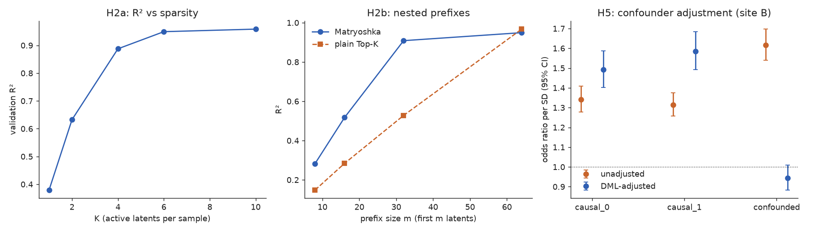

# glyph-mini

A minimal, educational re-implementation of **Glyph** ([paper note](../../02-paper-notes/glyph.md), [arXiv 2611.08922](https://arxiv.org/abs/2611.08922), [StanfordMIMI/Glyph](https://github.com/StanfordMIMI/Glyph)). It runs end to end on a laptop CPU in about 35 seconds.

Glyph takes **frozen foundation-model embeddings**, trains a **Matryoshka Top-K sparse autoencoder (SAE)** to turn each dense vector into a few active **concepts**, then runs a **concept-wide association study**. That means one logistic regression per (concept, outcome) pair, Bonferroni correction, replication on **external sites** with the frozen SAE, and **double/debiased ML (DML)** to adjust for confounders.

This PoC keeps every statistical and learning stage, and swaps the real foundation models and clinical data for a **synthetic world with known ground truth**. That swap is what makes it a test: we know which concepts exist, which ones cause the outcome, and which one is only confounded, so we can check whether each stage recovers the truth.

## Paper stage → PoC module

| Glyph stage (paper) | What it does | PoC | Simplification |
| --- | --- | --- | --- |
| 0. Frozen encoders (Merlin CT, Qwen3 reports, Labs FM) | dense embedding per patient | [`synthetic.py`](src/glyph_mini/synthetic.py) | `x = a @ D + noise`, with sparse non-negative `a` and 32 true unit-norm concepts in 64-d. This is the superposition assumption made explicit |
| 1. Matryoshka Top-K SAE | dense → sparse concepts | [`sae.py`](src/glyph_mini/sae.py), [`train.py`](src/glyph_mini/train.py) | dictionary 64 (not 8,192), K = 6 (not 40), prefixes (8, 16, 32, 64). Keeps decoder unit-norm, parallel-gradient removal, encoder gain calibration, ghost/aux loss for dead latents and early stopping, as in the code |
| 2. AutoInterp (Gemini names concepts) | human-readable labels | not implemented | the ground truth replaces it: we *measure* how well each feature matches a true concept (cosine similarity) |
| 3. Association study | per-SD odds ratio, Wald p | [`association.py`](src/glyph_mini/association.py) | Newton/IRLS logistic in numpy, SE from the inverse Fisher information |
| 4. Filters | Bonferroni at discovery, BH-FDR at replication | [`association.py`](src/glyph_mini/association.py), [`pipeline.py`](src/glyph_mini/pipeline.py) | site B is a shifted cohort (more frequent concepts, 1.5× noise, an offset) |
| 5. Confounder adjustment | partially linear logistic DML | [`dml.py`](src/glyph_mini/dml.py) | quadratic linear/logistic nuisances instead of XGBoost, 5-fold cross-fitting, sandwich SE |
| 6–7. Literature/Phecode comparison, MCP server | context and tooling | not implemented | not needed to understand the method |

## How to run

Requires [uv](https://docs.astral.sh/uv/) and Python 3.12.

```bash
cd research/virtual-cell-research/glyph-mini
uv sync                              # creates .venv with numpy, scipy, torch, matplotlib, pytest
uv run pytest                        # 18 tests, ~10 s
uv run python scripts/run_demo.py    # full run + 5-seed robustness, ~35 s
```

The demo prints a PASS/FAIL line per hypothesis, the underlying numbers and a seed table, and writes `results/results.json` and `results/figures/glyph-mini-{light,dark}.png`.

## Hypotheses the PoC validates

Each one is falsifiable, has a criterion fixed before running, and is checked both by `tests/test_pipeline.py` and by the demo.

| ID | Hypothesis (the Glyph claim being tested) | Success criterion | Null / what failure looks like |
| --- | --- | --- | --- |
| **H1 Recovery** | A Top-K SAE on dense embeddings recovers the underlying concept directions (the superposition premise behind "concepts") | mean over true concepts of max cosine(true direction, SAE decoder row) ≥ 0.9, beating a random dictionary by > 0.4; validation R² ≥ 0.85 | a random dictionary of the same size matches as well, or reconstruction is poor |
| **H2 Sparsity / Matryoshka** | (a) R² rises with K; (b) Matryoshka training front-loads general concepts into early latents | R²(K=1) < R²(K=2) < … ; prefix-8 R² Matryoshka > plain Top-K | flat R² vs K, or no prefix advantage |
| **H3 Discovery** | Univariate per-concept logistic regression with Bonferroni finds the outcome-relevant concepts and nothing else | all three relevant features significant with OR > 1, the top 3 by p are exactly those, no hits unrelated to the truth, 0 hits on a pure-noise outcome | missed causal concepts, or false positives on noise |
| **H4 Replication** | Frozen SAE + frozen normalizer, applied zero-shot to a shifted external site, reproduces the discoveries | ≥ 90% of discoveries replicate (BH 5%, same direction); site-B R² ≥ 0.8 | discoveries are site-specific artifacts |
| **H5 Confounding** | DML separates a concept that is associated with the outcome only through a confounder from truly causal concepts | confounded concept: unadjusted CI > 1, adjusted CI contains 1; causal concepts: adjusted CI > 1 | adjustment removes everything or nothing |

### Results (seed 0, from `scripts/run_demo.py`)

| | Result |
| --- | --- |
| H1 | mean max-cosine **0.978** (random dictionary 0.266); R² site A **0.949**, site B **0.901** |
| H2 | R² by K: 1 → 0.38, 2 → 0.63, 4 → 0.89, 6 → 0.95, 10 → 0.96. Prefix-8 R²: Matryoshka **0.28** vs plain 0.15; prefix-32: 0.91 vs 0.53; full: 0.95 vs 0.97 |
| H3 | 3/3 relevant features found, they are the top 3 by p, 0 false discoveries, 0 hits on the noise outcome |
| H4 | 3/3 discoveries replicate at site B |
| H5 | confounded: OR 1.62 [1.54, 1.70] → adjusted **0.94 [0.88, 1.01]**; causal: 1.34 → 1.49 [1.40, 1.59] and 1.31 → 1.59 [1.49, 1.69] |

All five hypotheses pass on seeds 0–4.



### Things worth noticing (each one is a lesson that also applies to the real paper)

- **Matryoshka trades a bit of full-dictionary R² (0.95 vs 0.97) for a much better small-prefix R².** This matches the paper's choice: they accept it because nested concepts generalise better across sites.
- **Adjusting *raises* the causal ORs (1.34 → 1.49).** This is not a bug. Odds ratios are **non-collapsible**: leaving out any strong predictor of Y (here W) shrinks a logistic coefficient towards 0, even when that predictor is not a confounder of it.
- **Rare features produce fake hits.** During development a feature that fired on only 4 held-out samples perfectly separated cases from controls on the *noise* outcome, giving p ≈ 0 and OR ≈ 0.01. The fix, which Glyph's code also uses, is to require ≥ 25 non-zero activations in the data being tested. The null-outcome test exists to catch this.
- **Polysemantic features exist even in toy data.** On seed 2 an extra feature was discovered. It matched no single true concept (best cosine 0.38) but correlated weakly with both causal concept c1 and confounded concept c2. The paper reports the same limitation. The pipeline reports these as `extra_discoveries` and counts only features unrelated to every relevant variable (|corr| < 0.05) as false.

## What the tests cover

| File | Checks |
| --- | --- |
| `tests/test_sae.py` | TopK leaves exactly K non-zeros; encoder initialised as decoder transpose with unit-norm rows; parallel-gradient removal leaves no radial component; full prefix = full reconstruction; the normaliser uses train statistics only (a shifted site is *not* re-centred); training reaches R² > 0.7 on a toy sparse signal and keeps the decoder unit-norm |
| `tests/test_association.py` | logistic regression recovers a known β; OR and SE match the 2×2-table closed form exactly; a null feature is not significant; Bonferroni threshold; Benjamini–Hochberg step-up (including a textbook example where BH rejects 2 and Bonferroni rejects 1) |
| `tests/test_dml.py` | DML recovers a known θ = 0.5 when T depends non-linearly on W; under pure confounding (θ = 0) its CI contains OR = 1 |
| `tests/test_pipeline.py` | H1–H5 end to end, on a smaller configuration |

## Deliberately left out

- **Real foundation models and clinical data.** Synthetic data is the only way to *know* the right answer, and patient data is not needed to learn the method.
- **AutoInterp (LLM concept naming).** It needs an LLM and real modality text. Here ground-truth cosine similarity plays its role.
- **XGBoost nuisances, literature agent, Phecode comparison, MCP server.** They are engineering around the core idea, not part of it.

## Layout

```
src/glyph_mini/  synthetic.py  sae.py  train.py  association.py  dml.py  pipeline.py
scripts/run_demo.py
tests/           test_sae.py  test_association.py  test_dml.py  test_pipeline.py  conftest.py
results/         results.json  figures/glyph-mini-{light,dark}.png
```
