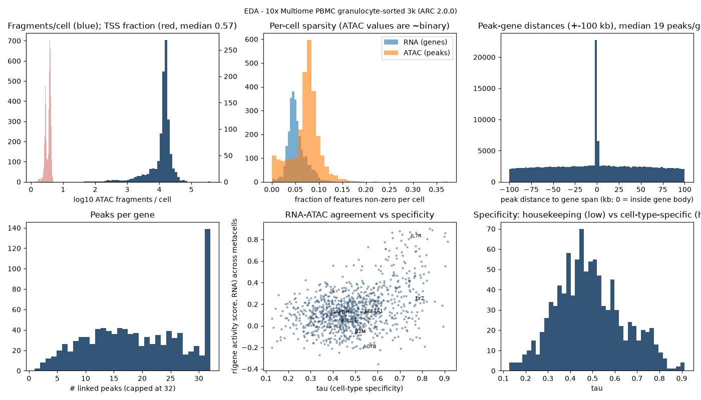
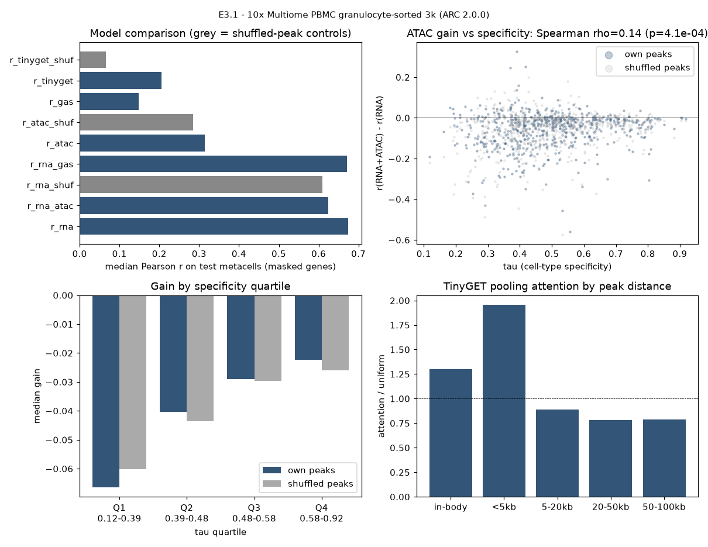

# E3.1: Is the ATAC information regulatory?

- **Roadmap phase**: [Phase 3](../00-plan/roadmap.md#phase-3-multi-omics-and-epigenetic-context) · Hypothesis ladder rung: 3
- **Status**: done
- **Started / finished**: 2026-11-25 / 2026-11-25
- **Driving paper**: GET, Fu et al. 2025 Nature ([note](../02-paper-notes/get-general-expression-transformer.md)), chosen by citation ranking in `04-experiments/_paper-selection/` (Phase 0 PR, branch `vcell/E0.2-tf-knockout-targets`).

> **Pre-registration.** Hypothesis, Why, Knowledge tested, Design and Metric were written on 2026-11-25 after a 1-seed pilot (`--quick`, used only to check the code runs, see Results → deviations) and before the confirmatory 3-seed run. Results and Conclusion are filled in from `get-mini/results/E3.1/results.json`.

## Hypothesis

- **H**: in paired RNA+ATAC data, adding a gene's *own* linked peaks to a model that predicts that gene's (masked) RNA from other genes' RNA improves accuracy more for cell-type-specific genes (high tau) than for housekeeping genes (low tau), and more than adding a *random other gene's* peaks.
- **Null**: the gain is uniform across tau, or no larger than the gain from shuffled peaks. Then ATAC only adds generic depth or cell-type information, which the other genes' RNA already carries.

## Why it moves the research forward

The Master's hypothesis assumes ATAC gives *regulatory* context for perturbation prediction. **(my take)**
- **If H holds**, gene-specific regulatory elements carry information RNA does not, which supports building region tokens into the Master's model (GET-style).
- **If H fails**, raw peak accessibility at this scale is mostly a second cell-type label. The model would then need motif- or TF-level features (chromVAR, GET's motif tokens), more cells, or deeper data before ATAC earns its place.

## Knowledge tested

- *Domain*: cis-regulatory elements (promoters, distal enhancers); housekeeping vs cell-type-specific genes; why scATAC is near-binary; TSS enrichment and FRiP as ATAC quality; peak-to-gene linking by distance.
- *Technical*: masked-gene prediction; ridge with GCV in the p ≈ n regime; per-gene stratified evaluation; Spearman of gain vs a covariate; feature-count-matched negative controls (shuffled peaks); a shared region-token transformer evaluated on unseen genes.

## Data primer

- **10x Multiome** measures RNA (gene UMI counts) and ATAC (Tn5 cut sites in open chromatin) in the *same* nucleus. Pairing is what lets us ask whether a gene's open chromatin predicts its own RNA.
- **Dataset**: 10x public "PBMC from a healthy donor, granulocytes removed through cell sorting (3k)", Cell Ranger ARC 2.0.0, `filtered_feature_bc_matrix.h5` (39 MB) + `per_barcode_metrics.csv`. 2,711 cells, 36,601 genes, 98,319 peaks. Public, anonymized; stored in the gitignored `get-mini/data/`.
- **One matrix, two modalities**: the h5 holds a single sparse features × cells matrix; `feature_type` separates "Gene Expression" rows from "Peaks" rows. `interval` gives gene spans and peak coordinates. The strand is not stored, so the TSS is ambiguous. We measure distance to the nearest gene-span edge instead.
- **Peak counts are cut sites, not fragments**: each fragment has two Tn5 ends, so a single fragment inside a peak counts 2. That is why "2" is the most common non-zero value (EDA below). Per cell, a peak is effectively 0/1: a diploid genome has only 2 copies to open.
- **Why metacells**: per-cell ATAC is 92% zeros, so a single cell's peak value is mostly sampling noise. We sum ~18 similar cells (k-means on a joint RNA PCA + ATAC LSI embedding, 150 metacells). Joint, so metacells are not defined by RNA alone. Cell types (8 k-means clusters on RNA PCA, labeled by marker genes) are used only to compute tau.

## Design

- **Genes**: the 1,000 most expressed genes (on metacells) detected in ≥5% of cells with ≥1 peak within ±100 kb of the gene span (no MT genes). Up to 32 nearest peaks per gene = its "region tokens".
- **Splits (per seed, 3 seeds)**: 20% of genes masked (their RNA is hidden from every input); 30% of metacells held out for testing. All scaling, PCA, ridge alphas and tau use training metacells only.
- **Per masked gene, ridge (alpha by GCV) fit on train metacells → Pearson r on test metacells**:
  - `rna`: 10 PCs of the visible genes' RNA (*simple baseline*: cell state from other genes).
  - `rna_atac`: + the gene's own peaks (z-scored log-CPM accessibility).
  - `rna_shuf`: + the peaks of a random other gene (**negative control**: same number of features and the same generic cell-type information, wrong regulatory elements).
  - `rna_gas`: + a single gene-activity score (GAS = log of distance-weighted sum of nearby accessibility, exp(−d/20 kb)).
  - `gas`: GAS alone, no fitting (classic ATAC→RNA baseline). `atac` / `atac_shuf`: own vs random peaks, no RNA.
- **TinyGET (minimal GET)**: one shared model across genes. Region tokens = [accessibility z, log accessibility, signed log-distance, |log-distance|, in-gene-body] → 2-layer transformer (d=32, 2 heads) → learned-query attention pooling → z-scored expression. No gene identity, no RNA input. Trained on visible genes × train metacells, evaluated on masked (unseen) genes × test metacells. Control: the same model trained and tested on gene-shuffled regions.
- **Code**: [`get-mini/`](../get-mini/) (`scripts/eda_multiome.py`, `scripts/run_e3_1.py`). Positive control: `--synthetic` runs the same pipeline on a generator where half the genes are enhancer-gated.

## Metric and success criterion

Decided before the confirmatory run:
1. **Primary**: Spearman ρ(gain, tau) > 0 with p < 0.05 (pooled over seeds), where gain = r(rna_atac) − r(rna).
2. **Specificity of the gain (required for H)**: gain > shuffled gain (one-sided paired Wilcoxon p < 0.05), *and* ρ(gain − gain_shuf, tau) > 0 with p < 0.05. Criterion 1 alone could come from tau correlating with something generic.
3. **Secondary (GET architecture)**: TinyGET median r on unseen genes > its shuffled-region control and > GAS (Wilcoxon p < 0.05).

H is supported only if 1 and 2 hold. Also reported: ρ(gain, #linked peaks) and the top genes by gain.

## EDA findings

Numbers from `get-mini/results/eda/eda.json`.

1. **Quality is good.** Median 14.5k ATAC fragments per cell. 57% of fragments overlap a TSS, the 10x TSS-enrichment proxy: open chromatin piles up at promoters, and low values flag dead cells or failed Tn5. FRiP is 0.70. *Biology*: promoters of active genes are the most consistently open sites. *ML*: QC metrics are covariates that a model can exploit as shortcuts.
2. **ATAC values are near-binary cut-site counts.** Of non-zero peak entries, 11% are 1, 65% are 2 and 25% are 3 or more. "2" means one fragment, counted at both Tn5 ends. Per cell, a peak is basically open or closed on its two alleles. *ML*: model it as Bernoulli/binarized (hence TF-IDF/LSI and pseudobulking), not as Gaussian.
3. **Similar per-cell sparsity, different meaning.** A median cell has 7.6% of 98k peaks non-zero vs 4.9% of 36k genes. But an RNA zero often means "lowly expressed, not sampled", while an ATAC zero in one cell says almost nothing about the population. *ML*: this motivates metacells. Per-cell ATAC→RNA regression is mostly noise.
4. **RNA depth and ATAC depth are independent per cell** (Spearman −0.03). Depth must be normalized per modality.
5. **Peak-gene distances are flat across ±100 kb, with a spike at 0.** 7.5% of links fall in the gene body and 16% within 5 kb. Median 19 peaks per gene; 23% of genes hit the 32-peak cap. *Biology*: most nearby peaks are *not* regulators of the gene, so distance alone is a weak prior. *ML*: many noisy tokens per gene call for attention or strong regularization.
6. **Gene-activity vs RNA agreement is weak overall but rises with specificity.** Median r across metacells is 0.13; its Spearman with tau is 0.33. IL7R (T-cell-specific) has r = 0.82; ACTB, GAPDH and B2M are ≈ 0 or negative. *Biology*: housekeeping promoters stay constitutively open, so their accessibility doesn't track small expression changes. Lineage genes open and close with cell identity. *ML*: this hints that ATAC–RNA agreement may be *cell-type* agreement, which is exactly what E3.1's shuffled control tests.
7. **Tau is moderate for almost everything (median 0.48).** There are only 8 clusters, 3 of them CD4 T, all immune. Even ACTB has tau 0.53 (higher in monocytes). *Caveat*: tau over similar immune clusters is a noisy specificity measure. A tissue-level tau (GTEx) would separate housekeeping genes better.

## Paper → minimal architecture

| GET (paper) | get-mini | Why |
|---|---|---|
| Region tokens = accessible regions in a cell type, features = accessibility + 282 TF-motif scores | Region tokens = up to 32 peaks within ±100 kb of a gene, features = accessibility + distance + in-gene-body | **Kept** the region-as-token idea. **Cut** motifs: they need the genome sequence and a motif scanner (a ~3 GB download plus extra tools). Distance stands in for "which regions matter" |
| ~200 regions per window, 12-layer transformer, pretrained on 213 fetal/adult cell types (masked-region objective) | 2-layer transformer, d=32, no pretraining, ~150 PBMC metacells | **Cut** scale and pretraining: there are too few metacells, and the question is about *information*, not capacity |
| Predicts expression of the gene whose promoter is in the region (per cell-type pseudobulk) | Predicts z-scored expression of a gene per metacell, attention-pooled over its regions | **Kept** pseudobulk targets and the regions → expression mapping |
| Leave-one-cell-type-out generalization | Unseen genes and unseen metacells | **Changed**: with one donor and 8 immune types, holding out a type leaves too little; unseen genes is the analogous "no gene identity" test |
| No RNA input | Ridge comparison adds other genes' RNA | **Added**: E3.1 asks what ATAC adds *on top of* RNA, which GET does not test |

## Results

**Confirmatory run**: 3 seeds × 200 masked genes (600 gene-seed pairs), 1,000 genes, 150 metacells (105 train / 45 test), 467 s on CPU. Files: `get-mini/results/E3.1/results.json`, `per_gene.json`.

**Median per-gene Pearson r on test metacells** (masked genes, pooled):

| Model | median r |
|---|---|
| rna (baseline: 10 PCs of other genes) | **0.674** |
| rna + own peaks | 0.624 |
| rna + shuffled peaks (neg. control) | 0.610 |
| rna + gene-activity score | 0.671 |
| own peaks only | 0.315 |
| shuffled peaks only (neg. control) | 0.284 |
| gene-activity score only (no fit) | 0.148 |
| TinyGET, unseen genes | 0.205 |
| TinyGET, shuffled regions (neg. control) | 0.065 |

**Pre-registered criteria:**

1. ρ(gain, tau) = **+0.144, p = 4e-4** (per seed: +0.18, +0.01, +0.26): *met*.
2. Gain vs shuffled gain: median −0.036 vs −0.036, Wilcoxon **p = 0.53**, so *not met*. ρ(gain − gain_shuf, tau) = **−0.015, p = 0.72**, also *not met*. The shuffled-peak gain correlates with tau just as strongly (ρ = +0.159, p = 9e-5).
3. TinyGET beats shuffled-region TinyGET (p = 3e-28) and beats GAS (p = 5e-17): *met*.

**Stratified results:**
- Adding peaks *hurts* in every tau quartile (−0.066 at low tau → −0.022 at high tau). The shuffled control tracks it within 0.007.
- More peaks hurt more. ρ(gain, #peaks) = −0.24; median gain is −0.004 for 1–5 peaks vs −0.049 for 16+.
- TinyGET's pooling attention, relative to uniform: 1.6–2.2× on peaks within 5 kb, 1.2–1.4× on gene-body peaks, below 1× beyond 5 kb. This is consistent across seeds.

**Genes where own peaks helped most** (vs shuffled): KLF2 (r 0.37 → 0.69 vs 0.34 shuffled), SCFD1 (0.63 → 0.72 vs 0.18), STAG1, P2RY8, SSH2, ZC3HAV1. KLF2 and P2RY8 are lymphocyte quiescence/trafficking genes. These are single-seed anecdotes, not a significant pattern.

**Positive control** (synthetic, `results/E3.1-synthetic/`, 3 seeds): the same pipeline *does* detect regulation when it exists:
- ρ(gain, tau) = +0.36 (p = 5e-7); ρ(gain − gain_shuf, tau) = +0.18 (p = 0.017); gain > shuffled (p = 9e-4).
- Enhancer genes gain +0.032, housekeeping genes −0.020.
- TinyGET beats shuffled (p = 7e-11).

So the PBMC null is not a pipeline that is blind by construction.

**Deviations from design:**
- A 1-seed `--quick` pilot on real data (500 genes) was run before pre-registration to debug the code. It showed the same pattern (gain ≈ shuffled gain), so the design was written knowing that one pilot result. The criteria were not changed afterwards.
- The full run uses 1,000 genes and 6 TinyGET epochs to stay near 10 min on CPU.
- TSS is approximated by the gene-span edge (the h5 has no strand).
- No second tissue (the roadmap design asks for PBMC + a second tissue).

## Conclusion

- **Verdict**: **H rejected** (for raw peak accessibility, at this scale). The ATAC gain does correlate with specificity (criterion 1), but a random gene's peaks give the same gain and the same correlation, so criterion 2 fails. On 105 training metacells, a gene's own peaks add nothing on top of other genes' RNA beyond what generic cell-state ATAC adds. Adding up to 32 noisy features costs more variance than it buys.
- **What I learned**:
  1. **"ATAC helps more for specific genes" is a trap without a shuffled control.** Specific genes are the ones whose expression tracks cell type, and *any* ATAC tracks cell type. Criterion 1 alone would have "confirmed" H. **(my take)**
  2. **The own-gene signal is real, but only a model that can't cheat sees it.**
     - A ridge fit per gene can use any peak as a cell-type proxy, so own ≈ shuffled (0.31 vs 0.28).
     - TinyGET has no gene identity, so it must read the *relation* between a gene's regions and its expression. Own scores 0.21 vs 0.07 for shuffled.
     - Unprompted, it learns to attend to promoter-proximal peaks. This is GET's design argument in miniature.
  3. **When features ≈ samples (p ≈ n), more regulatory features hurt.** Gain falls as #peaks rises. Region-level ATAC needs motif-level aggregation (GET's motif channels, chromVAR) or many more cell states and donors before it adds to RNA. **(my take)**
- **Progress signal met?**: partly. I can name genes where own peaks helped (KLF2, P2RY8, SCFD1) and say why that is plausible. The population-level pattern is not there.
- **Next step**: E3.1b.
  - (a) Motif/TF-activity features (chromVAR-style) instead of raw peaks.
  - (b) Evaluate where RNA *cannot* see the state: stimulated vs resting PBMC, or held-out cell types (GET-style).
  - (c) Strand-aware TSS from a GTF, and GTEx-based tau.

  Logged in the [research log](../research-log.md).
