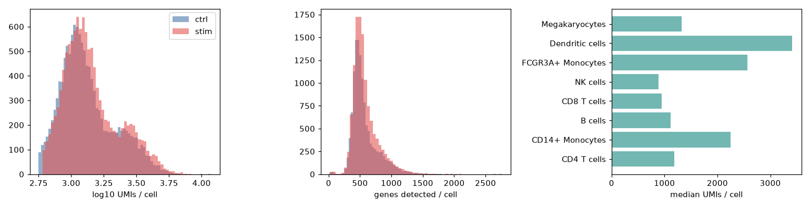
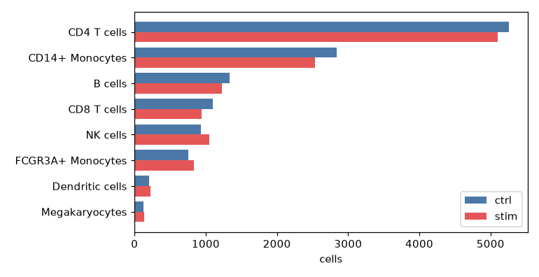
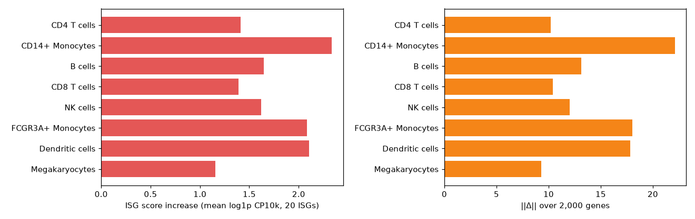
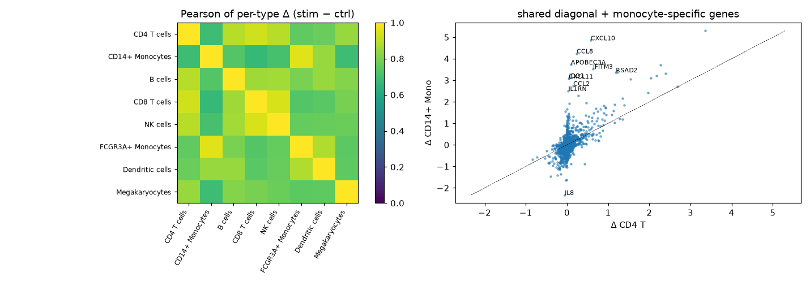
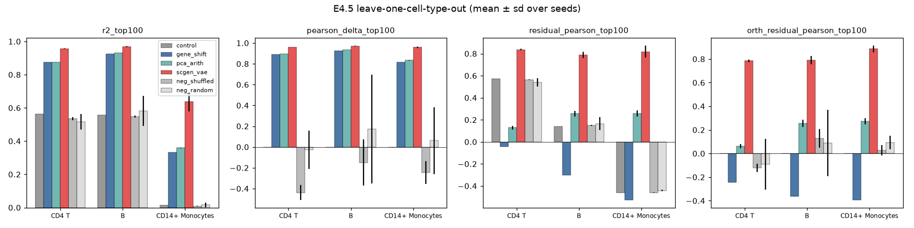

# E4.5: Does latent arithmetic predict the response of an unseen cell type?

- **Roadmap phase**: [Phase 4](../../00-plan/roadmap.md#phase-4-perturbation-modeling-and-causal-prediction) · Hypothesis ladder rung: 4
- **Status**: done
- **Started / finished**: 2026-11-25 / 2026-11-25
- **Driving paper**: scGen ([note](../../02-paper-notes/scgen.md)), picked by the citation ranking in `04-experiments/_paper-selection/` (Phase 0 PR, branch `vcell/E0.2-tf-knockout-targets`).

> **Pre-registration.** Hypothesis, Why, Knowledge tested, Design and Metric were written on 2026-11-25 *after* a single `--quick` pilot (8k cells, 1 seed, 8 epochs; used to check the pipeline runs end to end) and *before* the confirmatory run. The pilot numbers are not used for any verdict. Results and Conclusion come from `scgen-mini/results/E4.5/confirmatory.json`.

## Hypothesis

- **H1 (scGen's claim, minimal form)**: a mini scGen VAE that adds a latent δ (learned on the other cell types) to an unseen cell type's control cells beats the no-change baseline on R² of the top-100 DE genes for all 3 held-out types (CD4 T, B, CD14 Mono).
- **H2 (does the nonlinear latent space matter?)**: the VAE beats the *gene-space mean shift* by ≥ 0.05 R² (top-100 DE) on ≥ 2 of 3 types.
- **H3 (cell-type-specific skill, the [E4.4](../../00-plan/roadmap.md#experiments--hypotheses-4) test)**: after removing the generic shared response (Systema-style residual), the VAE's residual Pearson on the top-100 DE genes is ≥ 0.2 **and** at least 0.2 above the shuffled-label negative control on ≥ 2 of 3 types.
- **Null**: the VAE is no better than adding the average response in gene space (H2 fails), and whatever residual correlation it has is matched by the shuffled-δ control (H3 fails): all skill is the generic IFN response.

## Why it moves the research forward

[E4.1](../../00-plan/roadmap.md#experiments--hypotheses-4) needs an "unseen cell context" split, and E4.4 asks whether skill survives removing the shared response. scGen is the original "unseen context" model, and Kang 2018 is its own benchmark. So this is the cheapest place to find out whether "transfer a response across cell types" is real or mostly the generic program. **(my take)**

- **If H2/H3 hold**: a learned latent space carries cell-type-specific response information; the context-conditioned models in E4.1 are worth building, and latent arithmetic is the baseline they must beat.
- **If they fail**: the gene-space mean shift is the baseline to beat for unseen contexts, and any E4.1 claim must be Systema-corrected, because uncorrected R² is dominated by the shared ISG program.

## Knowledge tested

- *Domain*: type I interferon signaling (IFNAR → JAK1/TYK2 → STAT1/STAT2/IRF9 → ISGs); why monocytes respond more strongly than lymphocytes; shared vs cell-type-specific responses; PBMC cell types; demultiplexed donor pooling.
- *Technical*: VAE (ELBO, small-β), latent vector arithmetic, balanced δ, leave-one-cell-type-out OOD split, R² on means vs Δ metrics, energy distance, Systema-style residuals, label-shuffled and random-direction negative controls.

## Design

- **Data**: Kang et al. 2018 PBMC IFN-β, GEO [GSE96583](https://www.ncbi.nlm.nih.gov/geo/query/acc.cgi?acc=GSE96583) batch 2 (the same cells as pertpy `kang_2018` and scGen's `train_pbmc`). 8 lupus donors, pooled, split into ctrl and 6 h IFN-β, 10x v1, demultiplexed by genotype. Annotated singlets only: **24,594 cells**, 8 types. Normalised to 10k, log1p, top-2,000 variance genes. Downloaded from NCBI into the gitignored `scgen-mini/data/raw/` (pertpy's figshare mirror returned 403, so GEO was used directly).
- **Splits**: leave-one-cell-type-out. For held-out type T, training data = every cell except the *stimulated* T cells (as in scGen: T's control cells are seen). Prediction input = control T cells; truth = stimulated T cells. Primary T ∈ {CD4 T, B, CD14+ Monocytes}.
- **Models and baselines** (all δ are *balanced*: mean over training types of per-type stim − ctrl means):
  1. `control`: no change (simple baseline).
  2. `gene_shift`: ctrl_T + δ in gene space (the "generic response" model).
  3. `pca_arith`: δ in a 50-PC space, decode linearly (linear latent arithmetic).
  4. `scgen_vae`: mini scGen, z(ctrl_T) + δ_z, decode.
  5. `neg_shuffled` (negative control): same VAE, δ from condition labels shuffled within each type (δ ≈ 0, so it isolates the decoder's own bias).
  6. `neg_random` (negative control): same VAE, random latent direction with |δ| of the real one.
- **Seeds / compute**: 3 seeds (VAE init, PCA subsample), 30 epochs, CPU.
- **Code**: [`scgen-mini/`](./) · `uv run python -I scripts/run_e45.py`.

## Metric and success criterion

Per held-out type, mean over seeds:
- R² of mean expression, all genes and **top-100 DE genes** (scGen's metric; DE = top |Welch t| stim vs ctrl in T).
- Pearson of Δ (pred mean − ctrl mean vs true stim mean − ctrl mean) on top-100 DE.
- **Residual Pearson** on top-100 DE: Pearson of (pred Δ − generic) vs (true Δ − generic), generic = gene-space δ of the training types.
- Energy distance between predicted and true stim cells in a 30-PC space of real T cells.

Thresholds are those in the Hypothesis. Negative controls must score below `scgen_vae` on R² top-100 for the setup to be trusted.

## Data primer

PBMCs (peripheral blood mononuclear cells) are the white blood cells with one nucleus: T cells (CD4 helpers, CD8 killers), B cells, NK cells, monocytes (CD14+ "classical", FCGR3A/CD16+ "non-classical"), dendritic cells, plus megakaryocyte fragments (platelet precursors). **IFN-β** is a type I interferon, the alarm signal cells release when they detect a virus. Every nucleated cell has the receptor (IFNAR1/2). Binding activates JAK1/TYK2, which phosphorylate STAT1/STAT2. These bind IRF9 (the ISGF3 complex) and switch on hundreds of **interferon-stimulated genes** (ISGs: ISG15, IFI6, IFIT1/3, MX1, OAS1…). Because the pathway is shared, much of the response is the same in all cell types; on top of it, each type adds its own program (e.g. monocytes switch on chemokines such as CXCL10 and CCL8).

Kang pooled 8 donors in one well and demultiplexed cells by their SNPs, so donor effects are not confounded with condition. One matrix row is one cell; values are UMI counts; we work in log(1 + CP10k).

## EDA findings

Script: `scgen-mini/scripts/eda_kang.py` · figures in `scgen-mini/results/E4.5/`.

1. **QC is balanced across conditions.** Median 1,205 (ctrl) vs 1,284 (stim) UMIs and 508 vs 529 genes per cell: shallow 10x v1 data, but stimulation does not change depth much, so Δ is not a library-size artifact. Monocytes and DCs have ~2× the UMIs of lymphocytes (bigger cells, more mRNA). *ML link*: per-cell normalisation is required before comparing types.
2. **Composition is stable between conditions** (CD4 T 5,256/5,100, CD14 Mono 2,843/2,532, B 1,331/1,232, ..., megakaryocytes 124/132). 6 h of IFN-β does not create or destroy types, so a ctrl→stim mapping *within* a type is well defined. *ML link*: this is what makes the scGen split valid; it would not be for a differentiation perturbation.
3. **Monocytes respond hardest.** ISG score rises by 2.33 in CD14 Mono and 2.08 in FCGR3A Mono vs 1.41 in CD4 T; ||Δ|| is 22.1 vs 10.2, and 85 vs 18 genes move by more than 1 log unit. *Biology*: monocytes are innate sentinels. They express more of the pathway at baseline (higher ISG score already in ctrl: 0.28–0.49 vs 0.17), and on top of the ISGs they switch on an inflammatory program (CXCL10, CCL8, CCL2, CXCL11, IDO1, APOBEC3A, IL1RN) that lymphocytes lack. Some of this is plausibly an indirect, secondary response in 6 h (my take). *ML link*: one shared δ will underpredict monocytes.
4. **Most of the response is shared, but its amplitude is not.** Mean pairwise Δ correlation across the 8 types is 0.80. Regressing each type's Δ on the mean Δ of the *other* types explains 69–84% of its variance, but the slope ranges from 0.57 (megakaryocytes) and 0.67 (CD4 T) to 1.58 (CD14 Mono). The scatter shows the shared diagonal plus monocyte-only chemokines. *ML link*: the plain Systema residual (subtract generic) rewards any model that just gets the **amplitude** right. After this EDA I added an *exploratory* stricter metric that projects out the generic direction (`orth_residual_pearson_top100`), so only *which genes* counts. It is not part of the pre-registered criteria.

## Paper → minimal architecture

| scGen (paper) | scgen-mini | Why |
|---|---|---|
| VAE, 2 × 800 hidden, latent 100, dropout 0.2, BatchNorm, LeakyReLU | 2 × 256 hidden, latent 32, same blocks | CPU in minutes; latent 32 is still far above the response's intrinsic dimension |
| MSE reconstruction + α·KL with very small α | Σ_g MSE + 0.005·KL | small β keeps it near an autoencoder (informative latent) while smoothing it |
| δ = mean z(stim) − mean z(ctrl) after balancing cell types by resampling | average of per-type latent mean differences | same intent (no type dominates), deterministic |
| ~7,000 genes, Wilcoxon top-100 DE | 2,000 HVGs, Welch-t top-100 DE | speed; t is a close proxy for ranking |
| Baselines: CVAE, style transfer GAN, linear (PCA/vector arithmetic in gene space) | control, gene shift, PCA arithmetic | kept the linear ones, which are the ones that matter for E4.4 |
| — (not in paper) | Systema-style residual, shuffled-δ and random-δ controls, energy distance | the question "is the skill type-specific?" was not asked in 2019 |
| Cut | other datasets (Haber, Salmonella, species), cross-study transfer, UMAP of latent space | out of scope for a PoC |

## Results

Confirmatory run: 24,594 cells × 2,000 genes, 3 held-out types × 3 seeds, 30 epochs, 8.8 min on a laptop CPU. Mean ± sd over seeds ([JSON](./results/E4.5/confirmatory.json), quick pilot in [quick.json](./results/E4.5/quick.json)).

**R² top-100 DE genes** (scGen's metric; R² all genes in brackets)

| model | CD4 T | B | CD14 Mono |
|---|---|---|---|
| control (no change) | 0.56 (0.91) | 0.56 (0.85) | 0.01 (0.62) |
| gene shift | 0.87 (0.97) | 0.92 (0.97) | 0.33 (0.84) |
| PCA arithmetic | 0.88 (0.96) | 0.93 (0.97) | 0.36 (0.85) |
| **scGen VAE** | **0.96 ± 0.00** (0.98) | **0.97 ± 0.00** (0.98) | **0.64 ± 0.06** (0.91) |
| neg: shuffled δ | 0.53 | 0.55 | 0.01 |
| neg: random δ | 0.52 ± 0.05 | 0.58 ± 0.09 | 0.02 ± 0.01 |

**Residual Pearson, top-100 DE** (pre-registered Systema-style; projected version in brackets, exploratory)

| model | CD4 T | B | CD14 Mono |
|---|---|---|---|
| control | 0.57 (0.00) | 0.14 (0.00) | −0.46 (0.00) |
| gene shift | −0.04 (−0.24) | −0.30 (−0.36) | −0.53 (−0.39) |
| PCA arithmetic | 0.13 (0.06) | 0.26 (0.25) | 0.26 (0.27) |
| **scGen VAE** | **0.84 (0.79)** | **0.79 (0.79)** | **0.82 (0.89)** |
| neg: shuffled δ | 0.56 (−0.12) | 0.15 (0.13) | −0.46 (0.03) |
| neg: random δ | 0.54 (−0.09) | 0.17 (0.09) | −0.44 (0.09) |

**Energy distance** (30 PCs of real held-out cells; lower is better): control 6.8 / 9.7 / 22.7; gene shift **0.96 / 0.79** / 10.0; PCA 1.5 / 1.7 / 10.7; VAE 1.8 / 1.9 / **7.0**; negatives 9–26.

Observations:
- **Δ Pearson top-100**: gene shift 0.89 / 0.93 / 0.82; VAE 0.96 / 0.97 / 0.96.
- "No change" scores R² 0.85–0.91 on all genes for lymphocytes: all-gene R² on means mostly measures baseline expression.
- The control baseline's plain residual for CD4 T (0.57) is an artifact: CD4 T responds *less* than average (slope 0.67), so "−generic" correlates with "true − generic". The projected residual removes it (0.00). This is the amplitude problem from EDA finding 4.
- The gene shift's residuals are negative because of clipping at zero (log counts) and amplitude mismatch.
- The VAE has the best means but loses to the gene shift on energy distance for CD4 T and B: decoded cells are smoothed (less cell-to-cell variance). For monocytes, where the mean shift is far off, it wins anyway.

**Deviations**: pertpy's figshare mirror was blocked (403), so data came from GEO (same cells). One `--quick` pilot was run before the pre-registration was written. The projected residual metric was added after the EDA and is exploratory only.

## Conclusion

- **Verdict**: **H1 supported, H2 supported, H3 supported** (all 3 held-out types, all thresholds; projected residual agrees). Negative controls behave (≈ no-change everywhere).
  - H1: VAE > control on R² top-100 for 3/3 (0.96, 0.97, 0.64 vs 0.56, 0.56, 0.01).
  - H2: VAE − gene shift = +0.09, +0.05, +0.31 (≥ 0.05 on 3/3; B is right at the threshold).
  - H3: residual 0.84 / 0.79 / 0.82, gap over shuffled δ 0.28 / 0.64 / 1.28.
- **What I learned**:
  1. On Kang, a nonlinear latent space *does* transfer type-specific response, most visibly for monocytes (R² 0.33 → 0.64), consistent with scGen's claim. Linear PCA arithmetic does not: it is essentially the gene shift.
  2. The shared ISG program explains ~70–84% of every type's response. Uncorrected R² (especially on all genes) hides this; the simple Systema residual also rewards amplitude, so the projected residual is the honest version.
  3. Good means ≠ good distributions: the VAE decoder smooths cells, and energy distance catches it.
- **Caveat (my take)**: "unseen" is generous here. The held-out type's *control* cells are in training, and close relatives are present in both conditions (FCGR3A Mono and DCs for CD14 Mono; CD8 T and NK for CD4 T). The VAE likely places CD14 Mono ctrl next to FCGR3A Mono and borrows *their* response (the chemokines). This is transfer from a neighbour, not inference from biology. One dataset, one perturbation, one batch.
- **Progress signal met?**: yes for the PoC: the harness runs the E4.4-style test with negative controls on a real dataset, and the result survives it.
- **Next step**: hold out a whole lineage (both monocyte types + DCs) to remove the neighbour; add donor-level splits; then reuse this harness for the E4.1 "unseen cell context" arm.
