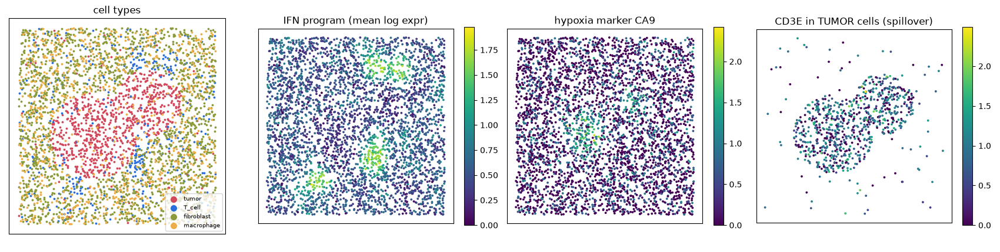
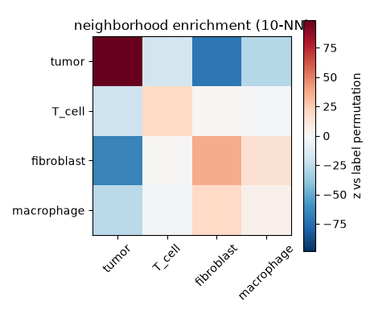
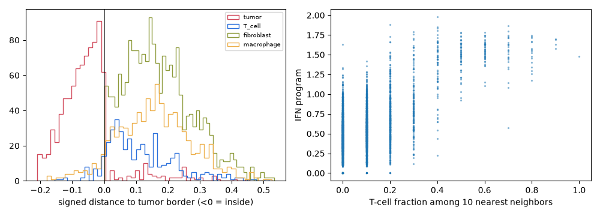
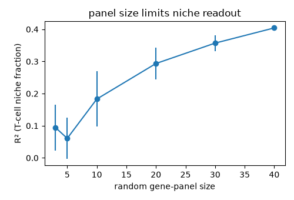
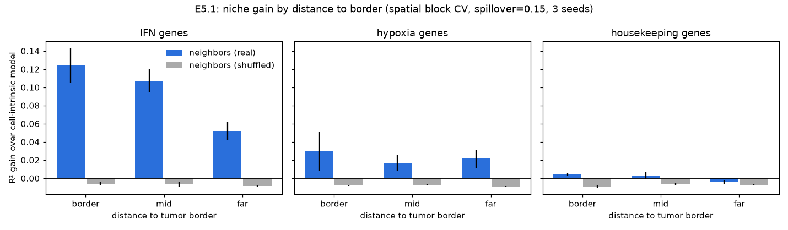
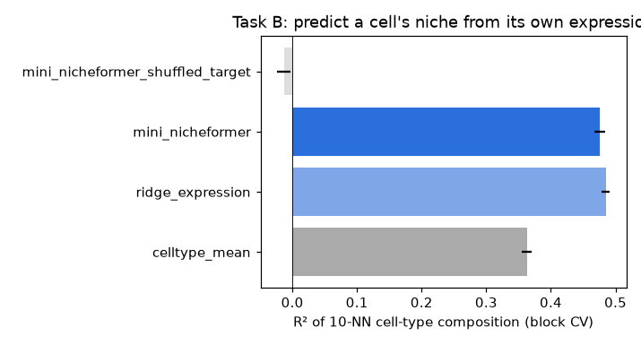

# E5.1: Does niche context add information beyond cell type?

- **Roadmap phase**: [Phase 5](../00-plan/roadmap.md#phase-5-spatial-and-tissue-level-modeling) · Hypothesis ladder rung: 5
- **Status**: done (synthetic toy only; real-data run pending)
- **Started / finished**: 2026-11-25 / 2026-11-25
- **Driving paper**: [Nicheformer](../02-paper-notes/nicheformer.md), chosen by the citation ranking in `04-experiments/_paper-selection/` (Phase 0 PR, branch `vcell/E0.2-tf-knockout-targets`).
- **Code**: [`nicheformer-mini/`](../nicheformer-mini/) · results in `nicheformer-mini/results/`

> **Pre-registration.** Hypothesis, Why, Knowledge tested, Design and Metric were fixed on 2026-11-25 before the confirmatory run. A `--quick` pilot (1 seed, 1,500 cells) was run only to check runtime. One change came from the unit tests, before any confirmatory number: ridge α raised from 1 to 30 because the niche model overfit pure-noise genes (housekeeping R² loss 0.03). Results and Conclusion come from `results/E5.1/results.json`.

## Hypothesis

- **H**: on a synthetic tumor section with known niche biology, a model that sees a cell's type + own markers **plus** its spatial neighbors predicts the niche-dependent IFN program better than the cell-intrinsic model, and the gain is largest within 0.05 of the tumor border. Shuffled neighbors give no gain, and genes with no spatial biology (housekeeping) gain nothing.
- **H-B (Nicheformer direction)**: a mini Nicheformer reading only one cell's rank-tokenized expression predicts its 10-NN cell-type composition better than the cell-type-mean baseline.
- **Null**: neighbor features add ≤ 0.01 R² on IFN genes, or the gain is the same everywhere, or the shuffled control gains as much (then the "gain" is extra parameters, not space).

## Why it moves the research forward

If spatial context doesn't help even for *unperturbed* expression, a spatial perturbation model (PhD H) is unlikely to help. The toy is where I learn the evaluation traps (spatial leakage, the cell-type shortcut, segmentation spillover) with the truth known, before running on MERFISH/Xenium. **(my take)**
- **If H holds**: run the same harness on a real tumor section, where the truth is *not* built in.
- **If H fails on the toy**: the harness or the features are broken, since the signal is there by construction.

## Knowledge tested

- *Domain*: TME layout (tumor nests, immune exclusion, peritumoral T-cell aggregates, stroma), paracrine signaling (IFN-γ from T cells → IFN-stimulated genes such as STAT1, CXCL9/10 in neighbors), hypoxic tumor cores, imaging panel sizes, segmentation spillover.
- *Technical*: rank-based gene tokenization with context tokens, k-NN graphs and mean message passing (a weightless GNN layer), neighborhood enrichment, spatial block CV vs random CV, R² stratified by distance, negative controls.

## Data primer

- **What real data looks like (paper/real tech)**: imaging spatial transcriptomics (MERFISH, Xenium, CosMx) gives, per segmented cell, counts for a fixed panel of ~100–500 genes plus x/y coordinates. Counts per cell are low (tens to hundreds), many entries are zero. Segmentation assigns transcripts to cells from images, and errors leak neighbors' transcripts into a cell.
- **What I simulated** ([`tissue.py`](../nicheformer-mini/src/nicheformer_mini/tissue.py)): 4,000 cells uniform on a unit square, 40 genes (a tiny "panel").
  - Tumor region = 2 disks. Inside: 88% tumor, 4% T (immune exclusion), 8% macrophage. Outside: fibroblasts/macrophages, plus 7 T-cell clusters placed 0.02–0.06 outside the border.
  - Genes: 20 markers (5 per type), 6 IFN genes driven by the true T-cell fraction within radius 0.06, 4 hypoxia genes in tumor cells deep (>~0.09) inside the tumor, 10 housekeeping genes with no spatial signal.
  - Poisson counts, ~60 per cell (45.7% zeros). Spillover: 15% of each cell's transcript mix comes from its 6 nearest neighbors (also run with 0%).
- **Public data**: not used. I planned to add squidpy's small MERFISH/IMC demos, but chose to keep the package dependency-free of scanpy/squidpy/anndata for this PoC. This is a deviation; the real-data run is the next step.

## EDA findings

Figures in `nicheformer-mini/results/eda/`, numbers in `eda_facts.json` (seed 0).

1. **Cell-type map**: tumor 21%, T 10%, fibroblast 47%, macrophage 21%. T cells hug the tumor border but rarely enter. *Biology*: "immune-excluded" tumor phenotype, a known predictor of poor immunotherapy response. *ML*: cell type and location are strongly coupled, so cell type alone already predicts a lot of the niche (the shortcut every niche model must beat).
2. **IFN map**: IFN genes light up around T-cell clusters; correlation of IFN score with 10-NN T-cell fraction r = 0.62. *Biology*: paracrine signaling has a short range (tens of µm). *ML*: the signal is in the neighbors, not in the cell's own type, which is exactly what a cell-intrinsic model can't see.
3. **Spillover map**: tumor cells near T cells show more CD3E (mean log 1.02 vs 0.69). *Biology/measurement*: a tumor cell does not express CD3E; this is segmentation error. *ML*: a "cell-intrinsic" model can secretly read its neighbors through spillover. That is why the shuffled-neighbor control and the spillover=0 vs 0.15 comparison exist.

4. **Neighborhood enrichment** (z vs label permutation): tumor–tumor z = 99, tumor–fibroblast z = −72, T–T z = 20, T–tumor z = −18. *ML*: strong self-affinity means random train/test splits of cells leak neighbors across the split; spatial block CV is needed.

5. **Distance to border**: 19.8% of cells lie within 0.05 of the border; T cells peak just outside it. *ML*: the "border" stratum is small, so per-bin R² is noisier there.

6. **Panel size**: ridge R² for the T-cell niche fraction grows with random panel size: 0.06–0.09 (3–5 genes), 0.18 (10), 0.29 (20), 0.40 (40). *Biology/tech*: imaging panels are small and chosen by humans; niche readout depends on whether the panel contains the right genes. This is why Nicheformer jointly pretrains on whole-transcriptome dissociated data. **(my take)**

## Paper → minimal architecture

| Nicheformer component | Kept? | Mini version | Why |
| --- | --- | --- | --- |
| Rank tokenization by expression / technology-specific gene mean | kept | top-16 genes by x / mean(x over training cells), zeros dropped | The core idea: a cell = ordered list of gene IDs, robust to depth and platform scale |
| Context tokens (species, modality, technology) | kept as tokens, inert | `[CLS] [TECH:imaging] [SPECIES:human]` prefix | Shows the mechanism; with one technology they carry no information |
| 12-layer, ~49M-param encoder, 1,500 tokens | cut | 2 layers, d=64, 4 heads, 16 tokens | CPU, 40-gene panel |
| Masked-token pretraining on 110M cells | cut | trained from scratch on the supervised target | No corpus; the PoC is about the task and the evaluation |
| Neighborhood composition head | kept | [CLS] → softmax over 4 types, soft cross-entropy vs 10-NN fractions | Nicheformer's main spatial task |
| Neighbor-aggregation (not in Nicheformer) | added | ridge on own features + mean of 10-NN markers + 10-NN composition + 2-hop composition | The roadmap's "niche → expression" direction; a linear 2-layer mean GNN |

## Design

- **Data**: synthetic tissue above; 3 seeds × spillover {0, 0.15}.
- **Splits**: spatial block CV (4×4 blocks → 4 folds, whole regions held out). Random-cell CV reported only as a leakage comparison.
- **Task A (expression from niche)**, targets = 20 non-marker genes (log-normalized):
  - `celltype_mean` (simple baseline); `intrinsic` = ridge on type one-hot + own 20 markers; `niche` = intrinsic + neighbor features; `niche_shuffled` = same but each cell receives a random other cell's neighborhood (**negative control**, also controls for added parameters).
- **Task B (niche from expression)**: targets = 10-NN type fractions. `celltype_mean` (baseline), `ridge_expression`, `mini_nicheformer`, `mini_nicheformer_shuffled_target` (**negative control**).

## Metric and success criterion

Pooled out-of-fold R² per gene, averaged within program; gain = R²(niche) − R²(intrinsic), stratified by |distance to border| (<0.05, 0.05–0.12, >0.12). Decided before the run, on spillover = 0.15, mean over 3 seeds:
- **P1**: IFN gain in the border bin ≥ 0.05 and larger than in the far bin.
- **P2**: shuffled-neighbor IFN gain ≤ 0.01 in every bin.
- **P3**: housekeeping gain ≤ 0.01 in every bin.
- **P4**: mini Nicheformer composition R² ≥ cell-type-mean + 0.05; shuffled-target ≤ 0.

## Results

3 seeds, 4,000 cells, 271 s total on a laptop CPU. Mean ± SD over seeds.

**Task A, R² gain over the cell-intrinsic model (spatial block CV, spillover = 0.15)**

| Program | border (<0.05) | mid | far (>0.12) | shuffled control (border) |
| --- | --- | --- | --- | --- |
| IFN | **+0.124 ± 0.019** | +0.107 ± 0.013 | +0.052 ± 0.010 | −0.006 ± 0.002 |
| hypoxia | +0.030 ± 0.022 | +0.017 ± 0.009 | +0.022 ± 0.010 | −0.008 |
| housekeeping | +0.004 ± 0.001 | +0.003 ± 0.004 | −0.004 ± 0.002 | −0.009 |

**Overall IFN R² (block CV)**: celltype mean 0.022, intrinsic 0.102, niche 0.188, niche-shuffled 0.095. Random CV inflates every model by ~0.004–0.015 (e.g., intrinsic 0.115). Without spillover: intrinsic IFN 0.095 (vs 0.102 with spillover); border gain 0.135.

**Task B, 10-NN composition R² (block CV, spillover 0.15)**

| Model | mean R² | tumor | T cell | fibroblast | macrophage |
| --- | --- | --- | --- | --- | --- |
| celltype mean | 0.363 | 0.708 | 0.068 | 0.533 | 0.143 |
| ridge on expression | **0.485** | 0.758 | 0.413 | 0.586 | 0.182 |
| mini Nicheformer | 0.476 | 0.714 | **0.472** | 0.563 | 0.154 |
| mini Nicheformer, shuffled target | −0.013 | ≈0 | ≈0 | ≈0 | ≈0 |

Criteria: **P1 pass** (0.124 ≥ 0.05, > 0.052). **P2 pass** (≤ −0.003 everywhere). **P3 pass** (max +0.004). **P4 pass** (+0.113 over cell-type mean; shuffled −0.013).

Deviations: no public dataset (synthetic only); ridge α changed during testing (above).

## Conclusion

- **Verdict**: H supported **on the toy**. This mostly validates the harness, because the niche effect and its border location were built into the simulator.
- **What I learned**:
  1. Cell type is a strong shortcut: it alone gives R² 0.36 for neighborhood composition, 0.71 for the tumor fraction. Neighborhood-prediction claims need a cell-type-mean baseline. The T-cell fraction is where expression adds most (0.07 → 0.47), because the IFN program is a readout of nearby T cells. **(my take)**
  2. The mini transformer matched but did not beat a ridge on the same 40 genes (0.476 vs 0.485). At this scale, rank tokenization throws away magnitudes and buys nothing; its value in the paper should come from pretraining and cross-platform transfer, which I did not test. **(my take)**
  3. Hypoxia barely improved (+0.02–0.03): my neighbor features (types, markers) don't encode *depth* inside the tumor. What the niche features can explain depends on the receptive field and on which features get aggregated. A deeper GNN or explicit distance features would be needed. **(my take)**
  4. 15% spillover moved the intrinsic model only slightly (IFN 0.095 → 0.102). Spillover is a real confound but a small one here; the shuffled-neighbor control still cleanly separates real context from extra parameters.
  5. Random-cell CV gave a small inflation on this toy (≤ 0.02). On real tissue with stronger autocorrelation, I expect it to be larger.
- **Progress signal met?**: partially. The harness returns a list of niche-dependent programs (IFN strongly, hypoxia weakly) with a biological reason, but only on synthetic data.
- **Next step**: same harness on a public MERFISH/Xenium tumor section (squidpy demos first), with segmentation-based spillover estimates and a GNN with distance features; then E5.2 (Perturb-map).
