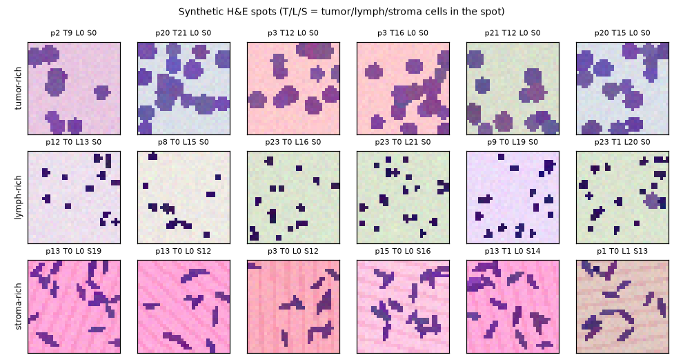
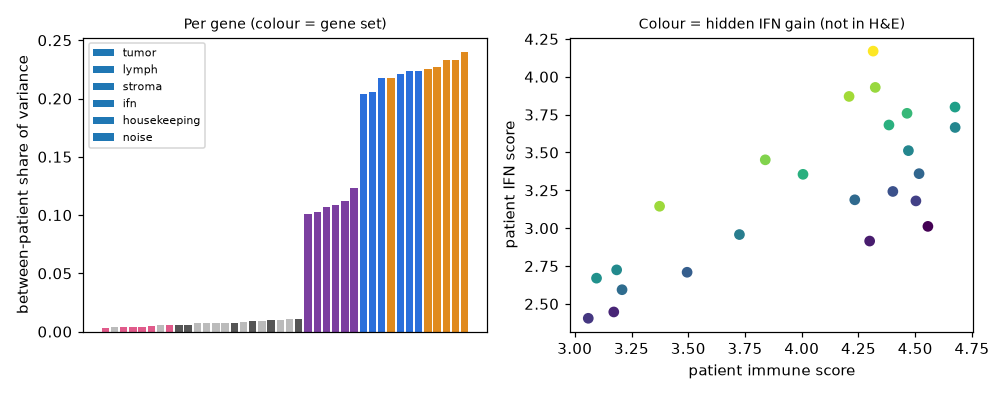
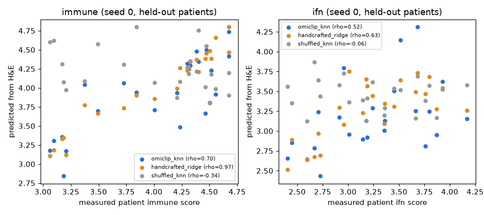
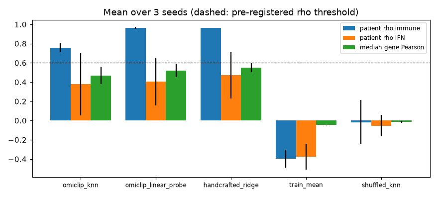

# E6.2: Can routine histology carry the virtual cell to patients?

- **Roadmap phase**: [Phase 6](../../00-plan/roadmap.md#phase-6-world-models-closed-loop-and-clinical-translation) · Hypothesis ladder rung: 6
- **Status**: done (synthetic toy; real paired H&E + Visium still to do)
- **Started / finished**: 2026-11-25 / 2026-11-25
- **Driving paper**: OmiCLIP / Loki ([note](../../02-paper-notes/omiclip-loki.md)), chosen from the Phase 6 citation ranking in `_paper-selection/` (Phase 0 PR); preferred over UNI by user decision.

> **Pre-registration.** Hypothesis, Why, Knowledge tested, Design and Metric were written on 2026-11-25 before the confirmatory seeds (0, 1, 2) were run. Only a `--quick` smoke run and a pilot on dev seed 1000 were looked at before that. Results and Conclusion come from [`results/E6.2/`](./results/E6.2/). Deviations are listed under Results.

## Hypothesis

- **H**: expression predicted from H&E tiles by a mini OmiCLIP (contrastive image ↔ gene-sentence model + kNN retrieval) preserves the *patient-level ranking* of two biomarkers on held-out patients: an **immune-infiltration** score (T-cell genes) and an **IFN/PD-L1-like** program score. Specifically Spearman ρ(predicted, measured) ≥ 0.6 and ≥ 0.3 above the shuffled-pair control, for each biomarker.
- **Null**: patient rankings from predicted maps don't track measured ones (ρ < 0.6, or no better than shuffled pairs).
- **Prediction made before running (my take)**: immune passes; IFN is harder, because in this world the IFN program also depends on a per-patient "IFN gain" that H&E cannot see. The ceiling for IFN is the ρ between the patient's true lymphocyte fraction and its measured IFN score.

## Why it moves the research forward

If rankings hold, the PhD's tissue model can be fed cheap routine slides, which is what makes clinical deployment realistic. If they fail, measured spatial data stays a requirement. The toy matters because it separates two failure modes a real dataset mixes up: *the model is too weak* vs *the biomarker is not in the morphology at all*. Knowing which biomarkers are "morphology-visible" is the progress signal the roadmap asks for. **(my take)**

- If H holds for both: move to real paired H&E + Visium (HEST-1k subset), same harness.
- If only immune holds: the deliverable is the list "inferable / not inferable from H&E", and state programs (IFN, PD-L1) need measured omics or a multimodal input.

## Knowledge tested

- *Domain*: what H&E shows (haematoxylin stains nuclei blue-purple, eosin stains cytoplasm/collagen pink); lymphocytes = small dark round nuclei, tumor = large pale crowded nuclei, stroma = elongated nuclei in pink collagen; Visium spot (~55 µm) ≈ 5–30 cells so expression is a *mixture*; IFN-γ from T cells induces PD-L1 (*CD274*), *STAT1*, *IRF1*, *CXCL9/10*, *IDO1*; inter- vs intra-patient heterogeneity; stain batch effects.
- *Technical*: CLIP / symmetric InfoNCE, gene-sentence tokenisation, retrieval-based regression (kNN in a shared space), linear probe, patient-grouped CV, rank metrics with bootstrap CIs, negative controls with broken pairs.

## Data primer

Synthetic, generated by [`simulate.py`](./src/omiclip_mini/simulate.py); no real or patient data. **Deviation from the brief**: the optional squidpy `visium_hne_adata` sample was not used. It is a single mouse brain section (one "patient"), so it can't test patient-level ranking, and adding scanpy/squidpy would multiply the dependency footprint. The synthetic world has known truth, which is what the question needs first.

- **Patients**: 24, each with an immune infiltration level ι ~ U(0.05, 0.5), a hidden IFN gain ~ LogNormal(0, 0.6) and an RGB stain multiplier ~ U(0.88, 1.08)³ (a batch effect with no biology).
- **Spots**: 150 per patient. Composition ~ Dirichlet(4·[0.8−ι, ι, 0.2] + 0.3); cells per spot ~ 3 + Poisson(14); cell types drawn multinomially.
- **Image**: a 32×32 RGB tile drawn from *the same cells*: eosin background whose saturation grows with stroma, collagen streaks, and one nucleus per cell (tumor r ≈ 2.4–3.4 px pale purple; lymphocyte r ≈ 1.1–1.5 px near-black; stroma 3:1 elongated). Pixel noise σ = 0.02.
- **Expression**: 46 genes = 6 tumor, 6 lymphocyte, 6 stroma, 6 IFN program, 6 housekeeping, 10 noise. Spot mean = Σ cells × type profile, plus IFN genes += 1.5 · gain_patient · n_lymphocytes. Counts ~ NB(θ = 5) with library factor LogNormal(0, 0.3). Then CP10k + log1p.
- **Gene sentence**: top-8 genes per spot ranked by per-gene z-score (z-stats from training patients only).
- **Biomarker score** (spot) = mean log-expression of its gene set; patient score = mean over spots. Immune = lymphocyte genes; IFN = IFN genes.

## EDA findings

From [`scripts/eda_e6_2.py`](./scripts/eda_e6_2.py), seed 0, [`eda.json`](./results/E6.2/eda.json).

1. **Nuclear darkness is the lymphocyte signal.** The fraction of near-black pixels correlates r = 0.84 with the spot's lymphocyte fraction and r = −0.66 with tumor fraction; medium-purple area tracks tumor (r = 0.78). *Biology*: dense heterochromatin of resting lymphocytes stains darkest with haematoxylin. *ML*: the signal is low-level (intensity + blob size), so a tiny CNN and even hand-crafted features should find it.
2. **A spot is a mixture, not a cell.** Median 17 cells per spot (6–32), and only 18% of spots are ≥ 80% one type. *Biology*: Visium ≠ single cell. *ML*: the target is a convex mixture of type profiles, which is exactly what kNN averaging of training spots produces.
3. **Raw gene sentences are mostly housekeeping.** Ranked by raw expression, 75% of sentence words are housekeeping genes (*ACTB*, *EEF1A1*, …); with per-gene z-scores, 17%. Example, a pure-lymphocyte spot: raw `EEF1A1 ACTB B2M TPT1 GAPDH RPLP0 CD8A CD3E`, z-scored `CD8A EEF1A1 CD3E NKG7 IDO1 IRF1 GZMB CD274`. *ML*: tokenisation choice decides what the text tower can learn. Housekeeping still leaks in because CP10k normalisation is compositional: a spot with few highly expressed marker genes inflates the share of the rest **(my take)**.
4. **Most variance is within patients.** Between-patient share of variance is 0.28 for the immune score and 0.36 for IFN, and ≈ 0 for stroma and housekeeping genes. *Biology*: intra-tumor heterogeneity dominates; the patient-level signal is a small shift on top. *ML*: averaging ~150 spots per patient is what makes a ranking possible even with noisy spot-level predictions.
5. **IFN is half-hidden.** Across patients, ρ(immune score, infiltration) = 0.97 but ρ(IFN score, immune score) = 0.66 and ρ(IFN, hidden gain) = 0.68. Anything that only sees morphology is capped near the immune part.

## Paper → minimal architecture

| OmiCLIP / Loki (paper) | omiclip-mini | Why |
| --- | --- | --- |
| ViT image encoder, CLIP-pretrained | 3-block CNN (16-32-64 ch, BN, GAP) → 64-d | 32-px synthetic tiles; CPU in minutes |
| Text transformer over gene-symbol sentence | Gene-token + rank-position embeddings, mean pool, 2-layer MLP → 64-d | Keeps the idea (symbols + order), drops the language model |
| Top expressed genes (filtered) | Top-8 by per-gene z-score | Raw ranking is all housekeeping (EDA 3) |
| Symmetric InfoNCE, learnable temperature | Same | The core idea, **kept** |
| ~2.2M pairs, many organs | 2,880 pairs per fold | Toy |
| Loki PredEx: similarity-weighted average of reference spots | Plain mean of k = 20 nearest training sentences to the query image | Simpler; weighting unlikely to change ranks |
| Align / Decompose / Retrieve tasks | Only Retrieve (top-5) and PredEx | E6.2 is about expression prediction |
| Rot/flip, colour augmentations | Rot90 + flip only | No stain augmentation, on purpose: tests the stain batch effect |

## Design

- **Splits**: 5-fold patient-grouped CV (≈ 5 test patients per fold). Every patient gets one out-of-fold prediction, so ρ is computed over 24 held-out patients. Gene z-stats, models and kNN references use training patients only.
- **Models**:
  - **omiclip_knn** (the hypothesis model): mini OmiCLIP, 30 epochs, batch 256, AdamW lr 2e-3; image embedding → kNN over training sentence embeddings → mean training expression.
  - **omiclip_linear_probe** (exploratory): ridge (λ = 1) from the frozen OmiCLIP image embedding to expression. Mirrors the roadmap's "pathology-FM + linear probe".
  - **handcrafted_ridge** (simple baseline): ridge from 11 hand-crafted features (mean/SD RGB, dark and medium-purple pixel fraction, blob counts, dark blob size).
  - **train_mean** (floor): training-set mean expression for every spot. Constant across patients, so ρ = 0 by construction; it anchors gene-level metrics.
  - **shuffled_knn** (negative control): identical pipeline, but image–sentence pairs are permuted once before training.
  - **Ceiling**: ρ(true patient lymphocyte fraction, measured biomarker). What a perfect cell counter on H&E would give.
- **Seeds**: confirmatory worlds 0, 1, 2 (each has its own patients, folds and init). Pilot/dev world 1000.
- **Code**: [`./`](./) — `scripts/run_e6_2.py` (`--quick` smoke test), `scripts/eda_e6_2.py`.

## Metric and success criterion

- **Primary**: per biomarker, Spearman ρ over the 24 held-out patients between mean predicted and mean measured score; 95% bootstrap CI over patients.
- **Decision rule (per world, per biomarker)**: pass if ρ(omiclip_knn) ≥ 0.6 **and** ρ(omiclip_knn) − ρ(shuffled_knn) ≥ 0.3. A biomarker "holds" if it passes in ≥ 2 of 3 worlds.
- **Verdict**: H supported if both biomarkers hold; *partially supported (biomarker-dependent)* if exactly one holds; rejected if neither.
- **Pilot gate (world 1000)**: immune ceiling ≥ 0.8 (the signal exists at 150 spots/patient) and |ρ(shuffled)| < 0.5 (the harness doesn't leak).
- **Secondary / exploratory**: median gene-level Pearson across spots; image→sentence top-5 retrieval among 100 held-out candidates (chance 0.05); omiclip vs linear probe vs hand-crafted.

## Results

Source: [`summary.json`, `decision.json`](./results/E6.2/) (seeds 0–2) and `pilot_*_seed1000.json`. Compute: 722 s for the 3 seeds on an Apple-silicon CPU (4 threads); `--quick` ≈ 20 s.

**Pilot (world 1000): passed.** Immune ceiling 0.99. Shuffled |ρ| = 0.41 (immune) and 0.46 (IFN), under the 0.5 gate but uncomfortably close (see the leave-patients-out artifact below). omiclip_knn: immune 0.81, IFN 0.38.

**Patient-level Spearman ρ (24 held-out patients) and median gene Pearson:**

| Model | ρ immune (s0 / s1 / s2) | ρ IFN (s0 / s1 / s2) | gene r (median, mean over seeds) |
| --- | --- | --- | --- |
| Ceiling (true lymphocyte fraction) | 0.98 / 0.99 / 0.99 | 0.66 / 0.41 / 0.71 | — |
| **omiclip_knn** | **0.70 / 0.75 / 0.81** | **0.52 / −0.07 / 0.68** | 0.47 |
| omiclip_linear_probe | 0.97 / 0.95 / 0.96 | 0.53 / 0.06 / 0.62 | 0.52 |
| handcrafted_ridge | 0.97 / 0.96 / 0.96 | 0.63 / 0.13 / 0.65 | 0.55 |
| train_mean | −0.32 / −0.34 / −0.53 | −0.19 / −0.52 / −0.42 | −0.04 |
| shuffled_knn (negative control) | −0.34 / 0.10 / 0.19 | −0.06 / 0.09 / −0.19 | −0.01 |

95% bootstrap CIs for omiclip_knn immune: [0.37, 0.88], [0.44, 0.92], [0.62, 0.91]. They are wide with 24 patients.

**Retrieval top-5 of 100** (chance 0.05): omiclip 0.19 / 0.19 / 0.23; shuffled 0.04 / 0.03 / 0.05.

**Decision**: immune passes in 3/3 worlds (holds); IFN passes in 1/3 (fails). Verdict per the pre-registered rule: **H partially supported (biomarker-dependent)**.

**Observations**
- IFN tracks the ceiling: whenever the morphology-only ceiling is low (seed 1: 0.41), every image model fails on IFN. The models are not the bottleneck there; the information is missing from H&E.
- **kNN retrieval is the weakest image model.** On the same frozen embedding, a ridge probe gives immune ρ ≈ 0.96 vs 0.70–0.81 for kNN. kNN averages 20 training spots, which shrinks predictions toward the training mean and compresses between-patient differences **(my take)**. Hand-crafted features + ridge are as good as anything here, because the signal is low-level (EDA 1).
- **Leave-patients-out artifact**: train_mean gets ρ ≈ −0.3 to −0.5, not 0. Each test fold is predicted with the mean of the *other* patients, which is lower when the held-out patients are high, so the ranking is anti-correlated. A "constant" baseline is not neutral under grouped CV, and the shuffled control inherits part of it. Worth remembering for real cohorts.

**Deviations**
1. No public Visium sample was used (see Data primer). Fully synthetic.
2. The full run takes ~12 min, so only `--quick` fits the "<10 min" budget.
3. The pilot `summary.json` was renamed to `pilot_*_seed1000.json` before the confirmatory run so it would not be overwritten. No code changed between pilot and confirmatory run.

## Conclusion

- **Verdict**: H partially supported (biomarker-dependent). Immune-infiltration ranking is preserved from H&E (ρ 0.70–0.81, 3/3 worlds) while median gene-level Pearson is only ≈ 0.47. The IFN/PD-L1-like program is not (1/3 worlds), which is what the world predicts: half of its patient variance comes from a gain that H&E cannot see.
- **What I learned**:
  - "Can H&E predict biomarker X?" splits into *is X a composition readout?* (yes → recoverable) and *is X a cell-state program?* (only as far as it correlates with composition). The morphology ceiling is the number to estimate first.
  - Patient-level ranking can be good while gene-level accuracy is moderate: averaging ~150 noisy spots per patient cancels spot noise, and most variance is within patients anyway.
  - Contrastive alignment works (retrieval 4× chance, shuffled at chance), but kNN PredEx compresses patient differences. A linear probe on the same embedding, or hand-crafted features, ranked patients better. A CLIP space is not automatically the best predictor.
  - Under patient-grouped CV a constant baseline is anti-correlated, not neutral.
- **Progress signal met?**: Yes, in toy form. Inferable from H&E: immune infiltration (and by design tumor/stroma composition). Not inferable: IFN/PD-L1-like state beyond its correlation with lymphocytes.
- **Next step**: the same harness on a small real paired H&E + Visium/Xenium cohort with several patients (HEST-1k subset), with a pathology-FM linear probe as the baseline and a measured "composition ceiling" from cell segmentation. Also try similarity-weighted / larger-k PredEx and stain augmentation.
